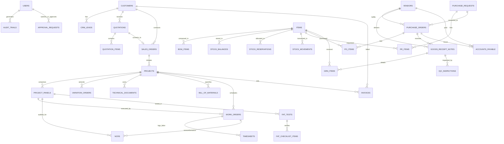

# PRODUCT REQUIREMENTS DOCUMENT (PRD)
## PanelERP: Sistem Manajemen Manufaktur Panel Listrik & Switchgear
### Dokumen Spesifikasi Struktur Database (Schema) & Kebutuhan Form Input Setiap Menu

- **Nama Dokumen:** PRD Struktur Database & Kebutuhan Form (PRDdatabaseForm.md)
- **Versi Dokumen:** 1.0.0
- **Status:** Final Draft
- **Target Sistem:** Database Relasional (PostgreSQL / MySQL) & Web Application (Vue 3 / REST API)
- **Karakter Bisnis:** Manufaktur Panel Listrik (Engineer-to-Order / Make-to-Order)

---

## 1. Pendahuluan & Ringkasan Eksekutif

PanelERP dirancang khusus untuk industri perakitan panel listrik (*electrical switchboard & switchgear builder*). Model bisnis perakitan panel beroperasi berdasarkan prinsip **Engineer-to-Order (ETO)** dan **Make-to-Order (MTO)**, yang memiliki kompleksitas khusus:
1. **Multi-panel per Proyek:** Satu kontrak proyek biasanya terdiri dari beberapa unit kubikel/panel (misal: Incoming ACB, Bus Coupler, Outgoing MCCB, Capacitor Bank, Sub-Distribution Panel).
2. **Hierarki Teknis Ketat:** Penawaran (Quotation) $\rightarrow$ Sales Order (SO) $\rightarrow$ Pembuatan BOM Teknis & Gambar Single Line Diagram (SLD) $\rightarrow$ Pengadaan Material Long-Lead $\rightarrow$ Fabrikasi Box & Busbar $\rightarrow$ Wiring $\rightarrow$ Testing QC / Factory Acceptance Test (FAT) $\rightarrow$ Pengiriman & BAST.
3. **Serial Number & Lot Tracking:** Komponen elektrikal bernilai tinggi (seperti Air Circuit Breaker / ACB, Molded Case Circuit Breaker / MCCB, Protection Relay, VFD/PLC) wajib dilacak menggunakan Nomor Seri unik. Material curah seperti Busbar Tembaga (Cu) dan Kabel dilacak per Lot/Batch.

Dokumen ini mendefinisikan:
- **Arsitektur & Skema Database Lengkap** (Tabel, Kolom, Tipe Data, Constraints, Foreign Keys, Indexing).
- **Kebutuhan Form Input & Modal Dialog Setiap Menu** (Nama Field, Tipe Kontrol, Validasi, Nilai Default, Formula/Aksi).

---

## 2. Diagram Hubungan Entitas (Entity Relationship Diagram - ERD)



---

## 3. Spesifikasi Kamus Data & Struktur Database Lengkap

### 3.1. Master Data (M0)

#### Tabel: `users` (Pengguna & Hak Akses)
| Nama Kolom | Tipe Data | Constraint | Keterangan |
|---|---|---|---|
| `id` | UUID / BIGINT | PRIMARY KEY, AUTO_INCREMENT | Identifier unik pengguna |
| `username` | VARCHAR(50) | UNIQUE, NOT NULL | Username login |
| `email` | VARCHAR(100) | UNIQUE, NOT NULL | Alamat email korporat |
| `password_hash` | VARCHAR(255) | NOT NULL | Hash kata sandi (Argon2/Bcrypt) |
| `full_name` | VARCHAR(100) | NOT NULL | Nama lengkap karyawan |
| `role` | VARCHAR(50) | NOT NULL | Role: `Direksi`, `Project Manager`, `Sales`, `Estimator`, `Manajer Teknik`, `QC`, `Produksi`, `Gudang`, `Finance`, `Admin` |
| `phone_number` | VARCHAR(30) | NULL | Nomor kontak WhatsApp / Telepon |
| `is_active` | BOOLEAN | DEFAULT TRUE | Status akun aktif/nonaktif |
| `last_login_at` | TIMESTAMP | NULL | Waktu login terakhir |
| `created_at` | TIMESTAMP | DEFAULT CURRENT_TIMESTAMP | Timestamp record dibuat |
| `updated_at` | TIMESTAMP | DEFAULT CURRENT_TIMESTAMP ON UPDATE | Timestamp record diubah |

#### Tabel: `customers` (Pelanggan / Klien)
| Nama Kolom | Tipe Data | Constraint | Keterangan |
|---|---|---|---|
| `id` | VARCHAR(30) | PRIMARY KEY | ID Pelanggan (e.g., `CST-001`) |
| `customer_code` | VARCHAR(50) | UNIQUE, NOT NULL | Kode Pelanggan (e.g., `CST-SEMEN`) |
| `company_name` | VARCHAR(150) | NOT NULL | Nama resmi perusahaan pelanggan |
| `customer_type` | ENUM | NOT NULL | Jenis: `BUMN`, `Swasta`, `Kontraktor`, `Pemerintah` |
| `tax_number_npwp`| VARCHAR(40) | NULL | Nomor NPWP 16 digit |
| `address` | TEXT | NOT NULL | Alamat kantor / penagihan |
| `city` | VARCHAR(100) | NOT NULL | Kota domisili |
| `pic_name` | VARCHAR(100) | NOT NULL | Nama Penanggung Jawab (PIC) |
| `pic_phone` | VARCHAR(30) | NOT NULL | Telepon PIC |
| `pic_email` | VARCHAR(100) | NULL | Email PIC |
| `payment_terms_days` | INT | DEFAULT 30 | Standar TOP (Term of Payment) hari |
| `is_active` | BOOLEAN | DEFAULT TRUE | Status pelanggan |
| `created_at` | TIMESTAMP | DEFAULT CURRENT_TIMESTAMP | Waktu input data |

#### Tabel: `vendors` (Pemasok & Subkontraktor)
| Nama Kolom | Tipe Data | Constraint | Keterangan |
|---|---|---|---|
| `id` | VARCHAR(30) | PRIMARY KEY | ID Vendor (e.g., `VND-001`) |
| `vendor_code` | VARCHAR(50) | UNIQUE, NOT NULL | Kode Vendor (e.g., `VND-SCH`) |
| `vendor_name` | VARCHAR(150) | NOT NULL | Nama perusahaan vendor |
| `category` | ENUM | NOT NULL | Kategori: `Pemasok`, `Subkontraktor` |
| `pic_contact` | VARCHAR(100) | NOT NULL | Nama personil kontak |
| `phone_number` | VARCHAR(30) | NOT NULL | Nomor telepon kantor/seluler |
| `email` | VARCHAR(100) | NULL | Email purchasing/sales vendor |
| `address` | TEXT | NULL | Alamat kantor/workshop vendor |
| `city` | VARCHAR(100) | NOT NULL | Kota vendor |
| `default_currency`| VARCHAR(5) | DEFAULT 'IDR' | Mata uang: `IDR`, `USD`, `EUR` |
| `payment_terms` | VARCHAR(50) | DEFAULT '30 hari' | Term of Payment |
| `standard_lead_time_days` | INT | DEFAULT 7 | Rata-rata lead time pengiriman (hari) |
| `rating` | DECIMAL(3,2) | DEFAULT 5.00 | Rating performa vendor (1.00 - 5.00) |
| `is_active` | BOOLEAN | DEFAULT TRUE | Status aktif vendor |

#### Tabel: `items` (Item Master / Komponen Elektrikal & Mekanikal)
| Nama Kolom | Tipe Data | Constraint | Keterangan |
|---|---|---|---|
| `id` | VARCHAR(30) | PRIMARY KEY | ID Master (e.g., `ITM-001`) |
| `item_code` | VARCHAR(80) | UNIQUE, NOT NULL | Kode SKU internal (e.g., `CB-ACB-4P-1600A-65kA`) |
| `item_name` | VARCHAR(150) | NOT NULL | Nama komponen / material |
| `category` | ENUM | NOT NULL | `Komponen Elektrikal`, `Material Mekanik`, `Kabel`, `Enclosure`, `Instrumen`, `Aksesori` |
| `brand` | VARCHAR(100) | NULL | Merek (Schneider, ABB, Siemens, Chint, dll.) |
| `model_type` | VARCHAR(100) | NULL | Seri / Model pabrikan (Masterpact NW, Tmax, dll.) |
| `uom` | VARCHAR(20) | NOT NULL | Satuan dasar: `PCS`, `MTR`, `KG`, `SET`, `ROLL` |
| `unit_price` | DECIMAL(15,2)| NOT NULL DEFAULT 0 | Harga perkiraan / purchase master price |
| `min_reorder_point`| DECIMAL(12,2)| NOT NULL DEFAULT 0 | Titik batas minimum pemesanan ulang (ROP) |
| `tracking_method`| ENUM | NOT NULL DEFAULT 'none' | Mode pelacakan: `none`, `lot`, `serial` |
| `lead_time_days` | INT | DEFAULT 0 | Lead time pengadaan item (long-lead indicator) |
| `status` | VARCHAR(20) | DEFAULT 'Aktif' | Status item: `Aktif`, `Obsolete` |
| `specifications` | TEXT | NULL | Catatan spesifikasi teknis / katalog |
| `created_at` | TIMESTAMP | DEFAULT CURRENT_TIMESTAMP | Tanggal input |

#### Tabel: `employees` (Karyawan / Tenaga Kerja Workshop)
*Dasar manajemen ketersediaan karyawan & estimasi biaya jasa produksi (Spesifikasi §8.8).*
| Nama Kolom | Tipe Data | Constraint | Keterangan |
|---|---|---|---|
| `id` | VARCHAR(20) | PRIMARY KEY | ID Karyawan (e.g., `EMP-001`) |
| `full_name` | VARCHAR(100) | NOT NULL | Nama lengkap teknisi/pegawai workshop |
| `role` | VARCHAR(50) | NOT NULL | Jabatan: `Teknisi`, `Kepala Regu`, `QC Inspector`, `Helper` |
| `skill` | ENUM | NOT NULL | Keahlian operasi: `Fabrikasi`, `Powder Coating`, `Rakit Mekanis`, `Wiring`, `QC` |
| `hourly_rate` | DECIMAL(12,2)| NOT NULL DEFAULT 0 | Tarif biaya jasa per jam (Rp/jam) — dasar estimasi `services_cost` |
| `work_hours_per_day` | DECIMAL(4,2) | NOT NULL DEFAULT 8.00 | Jam kerja efektif per hari (e.g., 8.00) |
| `phone_number` | VARCHAR(30) | NULL | Kontak aktif |
| `join_date` | DATE | NOT NULL | Tanggal bergabung |
| `is_active` | BOOLEAN | DEFAULT TRUE | Karyawan aktif dihitung dalam kapasitas & estimasi |
| `created_at` | TIMESTAMP | DEFAULT CURRENT_TIMESTAMP | Waktu input data |
| `updated_at` | TIMESTAMP | DEFAULT CURRENT_TIMESTAMP ON UPDATE | Waktu update data |

#### Tabel: `employee_absences` (Cuti / Sakit / Izin Karyawan)
| Nama Kolom | Tipe Data | Constraint | Keterangan |
|---|---|---|---|
| `id` | BIGINT | PRIMARY KEY, AUTO_INCREMENT | Identifier record |
| `employee_id` | VARCHAR(20) | FK -> `employees.id`, NOT NULL | Karyawan yang berhalangan |
| `absence_type` | ENUM | NOT NULL | `CUTI`, `SAKIT`, `IZIN`, `TUGAS_LUAR` |
| `date_from` | DATE | NOT NULL | Tanggal mulai tidak tersedia |
| `date_to` | DATE | NOT NULL | Tanggal akhir tidak tersedia ($\ge$ `date_from`) |
| `notes` | TEXT | NULL | Keterangan tambahan |
| `created_at` | TIMESTAMP | DEFAULT CURRENT_TIMESTAMP | Waktu input data |

#### Tabel: `work_calendar` (Kalender Kerja & Hari Libur Workshop)
| Nama Kolom | Tipe Data | Constraint | Keterangan |
|---|---|---|---|
| `date` | DATE | PRIMARY KEY | Tanggal kalender |
| `is_working_day` | BOOLEAN | NOT NULL DEFAULT TRUE | Hari kerja atau libur |
| `notes` | VARCHAR(150) | NULL | Keterangan (e.g., `Libur Nasional — Natal`) |

*Default konfigurasi (Settings): hari kerja Senin–Sabtu, 8 jam/hari. Tanggal libur nasional diinput sebagai baris `is_working_day = FALSE`.*

#### Tabel: `routing_templates` (Template Routing Produksi per Tipe Panel)
| Nama Kolom | Tipe Data | Constraint | Keterangan |
|---|---|---|---|
| `id` | VARCHAR(30) | PRIMARY KEY | ID Template (e.g., `RT-LVMDP-IN`) |
| `panel_type` | VARCHAR(50) | UNIQUE, NOT NULL | Tipe panel (e.g., `LVMDP-Incoming`) — 1:1 dengan tipe di BOM template |
| `label` | VARCHAR(100) | NOT NUL | Nama template routing |
| `is_active` | BOOLEAN | DEFAULT TRUE | Template aktif dipakai estimator & WO |
| `created_at` | TIMESTAMP | DEFAULT CURRENT_TIMESTAMP | Waktu input data |
| `updated_at` | TIMESTAMP | DEFAULT CURRENT_TIMESTAMP ON UPDATE | Waktu update data |

#### Tabel: `routing_operations` (Operasi & Jam Standar per Template Routing)
| Nama Kolom | Tipe Data | Constraint | Keterangan |
|---|---|---|---|
| `id` | BIGINT | PRIMARY KEY, AUTO_INCREMENT | Identifier operasi |
| `template_id` | VARCHAR(30) | FK -> `routing_templates.id`, NOT NULL | Template induk |
| `seq` | INT | NOT NULL | Urutan pengerjaan (1, 2, 3, …) |
| `stage` | ENUM | NOT NULL | `Fabrikasi`, `Powder Coating`, `Rakit Mekanis`, `Wiring`, `QC Internal`, `Packing` |
| `skill` | ENUM | NOT NULL | Keahlian yang dikerjakan (rujuk `employees.skill`) |
| `std_hours` | DECIMAL(8,2) | NOT NULL DEFAULT 0 | Jam standar per 1 unit panel — dasar estimasi biaya jasa & durasi |
| `is_parallel` | BOOLEAN | DEFAULT FALSE | Boleh berjalan paralel dengan operasi sebelumnya |
| `is_subcont` | BOOLEAN | DEFAULT FALSE | Operasi subkontrak (biaya jasa vendor, bukan tarif karyawan) |
| `subcont_cost` | DECIMAL(15,2) | NOT NULL DEFAULT 0 | Biaya jasa vendor per unit (bila `is_subcont = TRUE`) |

---

### 3.2. Penjualan & CRM (M1)

#### Tabel: `crm_leads` (Peluang & Prospek Penjualan)
| Nama Kolom | Tipe Data | Constraint | Keterangan |
|---|---|---|---|
| `id` | VARCHAR(30) | PRIMARY KEY | Identifier Lead (e.g., `LEAD-2026-001`) |
| `opportunity_name`| VARCHAR(200)| NOT NULL | Nama proyek prospek / tender |
| `customer_id` | VARCHAR(30) | FK -> `customers.id`, NOT NULL | Relasi ke calon/pelanggan |
| `estimated_value` | DECIMAL(15,2)| NOT NULL DEFAULT 0 | Estimasi nilai potensi proyek |
| `stage` | ENUM | NOT NULL | Tahap: `Lead`, `Kualifikasi`, `Penawaran`, `Negosiasi`, `Menang`, `Kalah` |
| `priority` | ENUM | NOT NULL DEFAULT 'Normal' | Prioritas: `Normal`, `Medium`, `Urgent` |
| `sales_owner_id` | BIGINT/UUID | FK -> `users.id`, NOT NULL | Sales in charge |
| `expected_closing_date` | DATE | NULL | Estimasi tanggal penutupan tender |
| `notes` | TEXT | NULL | Catatan requirement awal klien |

#### Tabel: `quotations` (Penawaran Harga)
| Nama Kolom | Tipe Data | Constraint | Keterangan |
|---|---|---|---|
| `id` | VARCHAR(30) | PRIMARY KEY | No. Penawaran (e.g., `QT-2026-031`) |
| `version` | VARCHAR(10) | NOT NULL DEFAULT 'v1' | Versi penawaran (e.g., `v1`, `v2`, `v3`) |
| `project_title` | VARCHAR(200) | NOT NULL | Judul proyek yang ditawarkan |
| `customer_id` | VARCHAR(30) | FK -> `customers.id`, NOT NULL | Pelanggan penerima penawaran |
| `currency` | VARCHAR(5) | DEFAULT 'IDR' | Mata uang: `IDR`, `USD` |
| `total_cost` | DECIMAL(15,2)| NOT NULL DEFAULT 0 | Total HPP / Estimasi biaya komponen + rakit |
| `target_margin_pct`| DECIMAL(5,2)| NOT NULL DEFAULT 20.00| Margin keuntungan kotor (%) |
| `total_value` | DECIMAL(15,2)| NOT NULL DEFAULT 0 | Nilai total penawaran jual ke klien |
| `issue_date` | DATE | NOT NULL | Tanggal terbit penawaran |
| `valid_until` | DATE | NOT NULL | Batas waktu masa berlaku penawaran |
| `payment_terms` | VARCHAR(150) | NOT NULL | Termin pembayaran yang disyaratkan |
| `prepared_by_user_id`| BIGINT/UUID| FK -> `users.id`, NOT NULL | Estimator pembuat penawaran |
| `status` | ENUM | NOT NULL DEFAULT 'Draft' | Status: `Draft`, `Menunggu`, `Menang`, `Kalah`, `Revisi` |
| `scope_of_work` | TEXT | NULL | Rincian lingkup kerja dan batasan garansi |
| `est_start_date` | DATE | NULL | Asumsi tanggal mulai perakitan untuk estimasi durasi |
| `est_days` | DECIMAL(7,2) | NULL | Estimasi lama perakitan (hari kerja) dari routing + kapasitas |
| `est_finish_date` | DATE | NULL | Estimasi tanggal selesai perakitan (turunan dari `est_start_date` + `est_days`) |
| `crm_estimated_value` | DECIMAL(15,2)| NULL | Snapshot `crm_leads.estimated_value` saat quotation dibuat |
| `crm_deviation_pct` | DECIMAL(5,2) | NULL | Selisih % harga cost-plus vs estimasi CRM (peringatan bila melebihi threshold) |
| `cost_snapshot_at` | TIMESTAMP | NULL | Waktu komputasi estimasi HPP (snapshot tidak berubah bila master berubah — §9.6) |

#### Tabel: `quotation_items` (Detail Rincian Penawaran)
| Nama Kolom | Tipe Data | Constraint | Keterangan |
|---|---|---|---|
| `id` | BIGINT | PRIMARY KEY, AUTO_INCREMENT | Identifier record rincian |
| `quotation_id` | VARCHAR(30) | FK -> `quotations.id`, NOT NULL | Relasi ke Quotation |
| `panel_name` | VARCHAR(150) | NOT NULL | Nama kubikel/panel (e.g., Incoming LVMDP) |
| `qty` | INT | NOT NULL DEFAULT 1 | Jumlah unit panel yang sama |
| `material_cost` | DECIMAL(15,2)| NOT NULL DEFAULT 0 | Biaya komponen & material elektrikal |
| `services_cost` | DECIMAL(15,2)| NOT NULL DEFAULT 0 | Biaya jasa rekayasa mekanik & wiring |
| `unit_price` | DECIMAL(15,2)| NOT NULL DEFAULT 0 | Harga jual per unit panel |
| `subtotal_price`| DECIMAL(15,2)| NOT NULL DEFAULT 0 | Total per baris |
| `est_manhours` | DECIMAL(8,2) | NOT NULL DEFAULT 0 | Estimasi total jam standar (Σ routing × qty) |
| `est_days` | DECIMAL(7,2) | NULL | Estimasi hari kerja baris ini (dibagi kapasitas keahlian dominan) |
| `price_override_reason` | TEXT | NULL | Alasan wajib bila `unit_price` ditangguhkan manual dari harga cost-plus |

#### Tabel: `sales_orders` (Kontrak / Sales Order)
| Nama Kolom | Tipe Data | Constraint | Keterangan |
|---|---|---|---|
| `id` | VARCHAR(30) | PRIMARY KEY | No. SO (e.g., `SO-2026-018`) |
| `quotation_id` | VARCHAR(30) | FK -> `quotations.id`, NULL | Referensi Penawaran pemenang |
| `customer_id` | VARCHAR(30) | FK -> `customers.id`, NOT NULL | Pelanggan pemilik kontrak |
| `customer_po_number`| VARCHAR(100)| NOT NULL | Nomor PO resmi dari Pelanggan |
| `project_name` | VARCHAR(200) | NOT NULL | Nama proyek panel |
| `contract_value`| DECIMAL(15,2)| NOT NULL | Nilai kontrak total (Exclude PPN) |
| `payment_terms` | VARCHAR(150) | NOT NULL | Termin bayar (e.g., 20% DP, 70% FAT, 10% BAST)|
| `retention_pct` | DECIMAL(5,2)| DEFAULT 5.00 | Persentase jaminan retensi garansi |
| `order_date` | DATE | NOT NULL | Tanggal PO pelanggan diterima |
| `target_delivery_date`| DATE | NOT NULL | Batas akhir pengiriman barang |
| `status` | ENUM | NOT NULL DEFAULT 'Draft' | Status: `Draft`, `Aktif`, `Selesai`, `Dibatalkan` |

---

### 3.3. Manajemen Proyek & Rekayasa Teknik (M2 & M3)

#### Tabel: `projects` (Header Data Proyek)
| Nama Kolom | Tipe Data | Constraint | Keterangan |
|---|---|---|---|
| `id` | VARCHAR(30) | PRIMARY KEY | No. Proyek (e.g., `PRJ-2026-001`) |
| `sales_order_id`| VARCHAR(30) | FK -> `sales_orders.id`, NULL | Referensi Sales Order |
| `customer_id` | VARCHAR(30) | FK -> `customers.id`, NOT NULL | Pelanggan |
| `name` | VARCHAR(200) | NOT NULL | Nama deskriptif proyek |
| `pm_user_id` | BIGINT/UUID | FK -> `users.id`, NOT NULL | Project Manager penanggung jawab |
| `contract_value`| DECIMAL(15,2)| NOT NULL | Nilai dasar kontrak proyek |
| `progress_pct` | DECIMAL(5,2)| DEFAULT 0.00 | Persentase progres agregat proyek (%) |
| `start_date` | DATE | NOT NULL | Tanggal kick-off proyek |
| `target_fat_date`| DATE | NULL | Target pelaksanaan FAT |
| `delivery_date` | DATE | NULL | Target pengiriman ke site |
| `actual_bast_date`| DATE | NULL | Tanggal penandatanganan BAST |
| `status` | ENUM | NOT NULL DEFAULT 'Engineering'| `Engineering`, `Siap Produksi`, `Produksi`, `QC/FAT`, `Siap Kirim`, `Terkirim`, `BAST`, `Ditutup` |

#### Tabel: `project_panels` (Daftar Panel / Kubikel per Proyek)
| Nama Kolom | Tipe Data | Constraint | Keterangan |
|---|---|---|---|
| `id` | VARCHAR(40) | PRIMARY KEY | Kode Panel (e.g., `PRJ-001-LVMDP-01`) |
| `project_id` | VARCHAR(30) | FK -> `projects.id`, NOT NULL | Relasi ke Proyek |
| `panel_name` | VARCHAR(150) | NOT NULL | Nama panel (e.g., `LVMDP-01 (Incoming)`) |
| `serial_number` | VARCHAR(80) | UNIQUE, NULL | Nomor Seri pabrikan (e.g., `SN-2026-001-01`) |
| `enclosure_size`| VARCHAR(100) | NULL | Dimensi box: T x L x D (mm) |
| `progress_pct` | DECIMAL(5,2)| DEFAULT 0.00 | Progres perakitan panel individual (%) |
| `current_stage` | ENUM | DEFAULT 'Fabrikasi' | `Fabrikasi`, `Powder Coating`, `Rakit Mekanis`, `Wiring`, `QC Internal`, `QC/FAT`, `Packing`, `Selesai` |
| `status` | VARCHAR(30) | DEFAULT 'Antrian' | Status operasional panel |

#### Tabel: `project_milestones` (Milestone Tahapan Proyek)
| Nama Kolom | Tipe Data | Constraint | Keterangan |
|---|---|---|---|
| `id` | BIGINT | PRIMARY KEY, AUTO_INCREMENT | ID Milestone |
| `project_id` | VARCHAR(30) | FK -> `projects.id`, NOT NULL | Relasi ke Proyek |
| `milestone_name`| VARCHAR(100) | NOT NULL | Tahap: Submittal, Material Ready, Prod Start, FAT, Delivery, BAST |
| `planned_date` | DATE | NULL | Target tanggal rencana |
| `actual_date` | DATE | NULL | Tanggal realisasi aktual |
| `status` | ENUM | NOT NULL DEFAULT 'Pending' | `Pending`, `Berjalan`, `Disetujui`, `Terlewat` |

#### Tabel: `bill_of_materials` (Header BOM Proyek / Panel)
| Nama Kolom | Tipe Data | Constraint | Keterangan |
|---|---|---|---|
| `id` | VARCHAR(40) | PRIMARY KEY | ID BOM (e.g., `BOM-2026-001-01`) |
| `project_id` | VARCHAR(30) | FK -> `projects.id`, NOT NULL | Proyek terkait |
| `panel_id` | VARCHAR(40) | FK -> `project_panels.id`, NULL | Panel terkait (jika spesifik per panel) |
| `bom_type` | ENUM | NOT NULL | Tipe: `Estimasi`, `Produksi` |
| `version` | VARCHAR(10) | NOT NULL DEFAULT 'v1' | Versi rilis BOM (e.g., `v1`, `v2`) |
| `status` | ENUM | NOT NULL DEFAULT 'Draft' | `Draft`, `In Review`, `Approved`, `Superseded` |
| `approved_by_user_id`| BIGINT/UUID| FK -> `users.id`, NULL | Manajer Teknik penyetujui |
| `approved_at` | TIMESTAMP | NULL | Waktu persetujuan teknis |

#### Tabel: `bom_items` (Rincian Komponen BOM)
| Nama Kolom | Tipe Data | Constraint | Keterangan |
|---|---|---|---|
| `id` | BIGINT | PRIMARY KEY, AUTO_INCREMENT | Identifier record BOM Item |
| `bom_id` | VARCHAR(40) | FK -> `bill_of_materials.id`, NOT NULL | Header BOM |
| `item_id` | VARCHAR(30) | FK -> `items.id`, NOT NULL | Komponen yang digunakan |
| `required_qty` | DECIMAL(12,2)| NOT NULL | Jumlah kuantitas kebutuhan |
| `uom` | VARCHAR(20) | NOT NULL | Satuan ukuran komponen |
| `designator` | VARCHAR(100) | NULL | Label penandaan gambar (e.g., `Q1`, `KM1`, `F1`) |
| `is_long_lead` | BOOLEAN | DEFAULT FALSE | Indikator material waktu pengadaan lama |
| `remarks` | VARCHAR(255) | NULL | Catatan spesifikasi/alternatif komponen |

#### Tabel: `technical_documents` (Dokumen Gambar Teknik & SLD)
| Nama Kolom | Tipe Data | Constraint | Keterangan |
|---|---|---|---|
| `id` | VARCHAR(40) | PRIMARY KEY | ID Dokumen (e.g., `DOC-SLD-001`) |
| `project_id` | VARCHAR(30) | FK -> `projects.id`, NOT NULL | Proyek terkait |
| `document_name`| VARCHAR(150) | NOT NULL | Judul gambar/dokumen |
| `document_type`| ENUM | NOT NULL | `SLD`, `Layout`, `Wiring`, `BOM`, `Datasheet`, `Cable Schedule` |
| `file_name` | VARCHAR(200) | NOT NULL | Nama file asli (e.g., `SLD-PRJ-2026-v3.pdf`) |
| `file_path` | VARCHAR(255) | NOT NULL | Path penyimpanan file (Local/S3/MinIO) |
| `file_size_bytes`| BIGINT | NOT NULL | Ukuran file dalam bytes |
| `version` | VARCHAR(10) | NOT NULL DEFAULT 'v1' | Versi revisi gambar |
| `status` | ENUM | NOT NULL DEFAULT 'Draft' | `Draft`, `Issued for Review`, `Approved for Construction`, `As-Built` |
| `uploaded_by_user_id`| BIGINT/UUID| FK -> `users.id`, NOT NULL | Engineer/Drafter pengunggah |
| `client_approved`| BOOLEAN | DEFAULT FALSE | Status approval dari portal klien |

---

### 3.4. Inventaris & Pergudangan (M5)

#### Tabel: `warehouses` & `warehouse_locations` (Gudang & Lokasi Rak)
| Nama Kolom | Tipe Data | Constraint | Keterangan |
|---|---|---|---|
| `id` | VARCHAR(20) | PRIMARY KEY | ID Lokasi (e.g., `LOC-A3`) |
| `warehouse_name`| VARCHAR(100) | NOT NULL | Nama Gudang: `Gudang Utama`, `Gudang B2`, `Area Produksi` |
| `bin_rack_code`| VARCHAR(50) | NOT NULL | Kode Bin/Rak (e.g., `Rak A3 - Tray 2`) |

#### Tabel: `stock_balances` (Saldo Stok Fisik per Lokasi)
| Nama Kolom | Tipe Data | Constraint | Keterangan |
|---|---|---|---|
| `id` | BIGINT | PRIMARY KEY, AUTO_INCREMENT | ID Saldo Stok |
| `item_id` | VARCHAR(30) | FK -> `items.id`, NOT NULL | Item Master |
| `location_id` | VARCHAR(20) | FK -> `warehouse_locations.id`, NOT NULL | Lokasi penyimpanan |
| `qty_on_hand` | DECIMAL(12,2)| NOT NULL DEFAULT 0 | Jumlah fisik yang ada di rak |
| `qty_reserved`| DECIMAL(12,2)| NOT NULL DEFAULT 0 | Jumlah yang dicadangkan untuk proyek |
| `qty_quarantine`| DECIMAL(12,2)| NOT NULL DEFAULT 0 | Jumlah dalam inspeksi IQC / NCR |

#### Tabel: `stock_reservations` (Alokasi Pencadangan Material Proyek)
| Nama Kolom | Tipe Data | Constraint | Keterangan |
|---|---|---|---|
| `id` | VARCHAR(40) | PRIMARY KEY | ID Reservasi (e.g., `RES-2026-001`) |
| `project_id` | VARCHAR(30) | FK -> `projects.id`, NOT NULL | Proyek yang memesan |
| `panel_id` | VARCHAR(40) | FK -> `project_panels.id`, NULL | Panel spesifik penerima |
| `item_id` | VARCHAR(30) | FK -> `items.id`, NOT NULL | Komponen yang dicadangkan |
| `reserved_qty` | DECIMAL(12,2)| NOT NULL | Jumlah kuantitas yang dialokasikan |
| `picked_qty` | DECIMAL(12,2)| NOT NULL DEFAULT 0 | Jumlah yang telah diambil workshop |
| `reservation_date`| TIMESTAMP | DEFAULT CURRENT_TIMESTAMP | Tanggal pencadangan |
| `status` | ENUM | NOT NULL DEFAULT 'Reserved'| `Reserved`, `Partial Picked`, `Fully Picked`, `Cancelled` |

#### Tabel: `stock_movements` (Mutasi Kartu Stok)
| Nama Kolom | Tipe Data | Constraint | Keterangan |
|---|---|---|---|
| `id` | BIGINT | PRIMARY KEY, AUTO_INCREMENT | ID Mutasi |
| `transaction_time`| TIMESTAMP | DEFAULT CURRENT_TIMESTAMP | Waktu terjadinya transaksi fisik |
| `movement_type`| ENUM | NOT NULL | `GRN`, `Issue`, `Return`, `Transfer`, `Adjustment`, `Scrap` |
| `item_id` | VARCHAR(30) | FK -> `items.id`, NOT NULL | Komponen yang bermutasi |
| `qty` | DECIMAL(12,2)| NOT NULL | Qty mutasi (positif = masuk, negatif = keluar)|
| `reference_doc_type`| VARCHAR(50)| NOT NULL | Tipe dokumen referensi (PO, GRN, WO, Manual) |
| `reference_doc_id`| VARCHAR(50) | NOT NULL | Nomor dokumen referensi |
| `serial_or_lot_number`| VARCHAR(100)| NULL | Nomor seri / batch lot komponen |
| `user_id` | BIGINT/UUID | FK -> `users.id`, NOT NULL | Petugas yang mengeksekusi mutasi |
| `notes` | VARCHAR(255) | NULL | Keterangan tambahan transaksi |

---

### 3.5. Pengadaan / Purchasing (M6)

#### Tabel: `purchase_requests` (Permintaan Pembelian)
| Nama Kolom | Tipe Data | Constraint | Keterangan |
|---|---|---|---|
| `id` | VARCHAR(30) | PRIMARY KEY | No. PR (e.g., `PR-2026-088`) |
| `project_id` | VARCHAR(30) | FK -> `projects.id`, NOT NULL | Proyek peminta |
| `item_id` | VARCHAR(30) | FK -> `items.id`, NOT NULL | Komponen yang diminta |
| `requested_qty`| DECIMAL(12,2)| NOT NULL | Jumlah kuantitas yang dibutuhkan |
| `uom` | VARCHAR(20) | NOT NULL | Satuan ukuran |
| `estimated_unit_price`| DECIMAL(15,2)| NULL | Estimasi harga satuan |
| `estimated_total_value`| DECIMAL(15,2)| NULL | Estimasi total nilai pembelian |
| `priority` | ENUM | NOT NULL DEFAULT 'Medium'| `Low`, `Medium`, `High` |
| `requested_by_user_id`| BIGINT/UUID| FK -> `users.id`, NOT NULL | Staf proyek/gudang pemohon |
| `request_date` | DATE | NOT NULL | Tanggal pengajuan |
| `status` | ENUM | NOT NULL DEFAULT 'Draft' | `Draft`, `Pending`, `Approved`, `Rejected`, `PO Dibuat` |
| `justification` | TEXT | NULL | Alasan kebutuhan pengadaan |

#### Tabel: `purchase_orders` (Pesanan Pembelian ke Vendor)
| Nama Kolom | Tipe Data | Constraint | Keterangan |
|---|---|---|---|
| `id` | VARCHAR(30) | PRIMARY KEY | No. PO (e.g., `PO-2026-156`) |
| `vendor_id` | VARCHAR(30) | FK -> `vendors.id`, NOT NULL | Vendor penerima order |
| `project_id` | VARCHAR(30) | FK -> `projects.id`, NOT NULL | Proyek yang dibebankan |
| `order_date` | DATE | NOT NULL | Tanggal PO diterbitkan |
| `expected_delivery_date`| DATE | NOT NULL | Batas waktu kedatangan (ETA) |
| `currency` | VARCHAR(5) | DEFAULT 'IDR' | Mata uang: `IDR`, `USD`, `EUR` |
| `subtotal_amount`| DECIMAL(15,2)| NOT NULL DEFAULT 0 | Nilai sebelum pajak |
| `tax_amount` | DECIMAL(15,2)| NOT NULL DEFAULT 0 | Nilai PPN |
| `total_amount` | DECIMAL(15,2)| NOT NULL DEFAULT 0 | Total nilai order pembelian |
| `payment_terms` | VARCHAR(100) | NOT NULL | Syarat pembayaran vendor |
| `status` | ENUM | NOT NULL DEFAULT 'Draft' | `Draft`, `Pending Approval`, `Open`, `Partial GRN`, `GRN Selesai`, `Cancelled` |
| `created_by_user_id`| BIGINT/UUID| FK -> `users.id`, NOT NULL | Purchasing buyer |

#### Tabel: `goods_receipt_notes` (Bukti Penerimaan Barang - GRN)
| Nama Kolom | Tipe Data | Constraint | Keterangan |
|---|---|---|---|
| `id` | VARCHAR(30) | PRIMARY KEY | No. GRN (e.g., `GRN-2026-089`) |
| `purchase_order_id`| VARCHAR(30)| FK -> `purchase_orders.id`, NOT NULL| Referensi PO |
| `vendor_id` | VARCHAR(30) | FK -> `vendors.id`, NOT NULL | Vendor pengirim |
| `delivery_note_vendor`| VARCHAR(100)| NOT NULL | No. Surat Jalan resmi vendor |
| `receipt_date` | DATE | NOT NULL | Tanggal fisik barang diterima di gudang |
| `total_received_qty`| DECIMAL(12,2)| NOT NULL | Total akumulasi kuantitas barang |
| `received_by_user_id`| BIGINT/UUID| FK -> `users.id`, NOT NULL | Petugas gudang penerima barang |
| `status` | ENUM | NOT NULL DEFAULT 'IQC Pending'| `IQC Pending`, `Selesai`, `Retur Parsial` |

---

### 3.6. Produksi & Operasional Workshop (M7)

#### Tabel: `work_orders` (Surat Perintah Kerja Perakitan Panel)
| Nama Kolom | Tipe Data | Constraint | Keterangan |
|---|---|---|---|
| `id` | VARCHAR(40) | PRIMARY KEY | No. WO (e.g., `WO-2026-001-01`) |
| `project_id` | VARCHAR(30) | FK -> `projects.id`, NOT NULL | Proyek terkait |
| `panel_id` | VARCHAR(40) | FK -> `project_panels.id`, NOT NULL | Panel yang dirakit |
| `current_stage` | ENUM | NOT NULL DEFAULT 'Fabrikasi'| `Fabrikasi`, `Powder Coating`, `Rakit Mekanis`, `Wiring`, `QC Internal`, `QC/FAT`, `Packing`, `Selesai` |
| `progress_pct` | DECIMAL(5,2)| DEFAULT 0.00 | Progres tahapan fisik WO (%) |
| `team_lead_name`| VARCHAR(100) | NOT NULL | Kepala regu teknisi (e.g., `Tim A: Joko`) |
| `start_date` | DATE | NOT NULL | Tanggal mulai pekerjaan |
| `due_date` | DATE | NOT NULL | Batas akhir target perakitan |
| `estimated_manhours`| DECIMAL(8,2)| NOT NULL DEFAULT 0 | Estimasi total jam kerja yang dialokasikan |
| `actual_completed_hours`| DECIMAL(8,2)| NOT NULL DEFAULT 0 | Jam kerja aktual yang telah digunakan |
| `status` | ENUM | NOT NULL DEFAULT 'On Track' | `On Track`, `At Risk`, `Delayed`, `Selesai` |
| `routing_template_id`| VARCHAR(30) | FK -> `routing_templates.id`, NULL | Template routing yang dipakai — sumber jam standar estimasi |

#### Tabel: `timesheets` (Catatan Jam Kerja Teknisi)
| Nama Kolom | Tipe Data | Constraint | Keterangan |
|---|---|---|---|
| `id` | VARCHAR(30) | PRIMARY KEY | ID Log Kerja (e.g., `TS-001`) |
| `work_order_id`| VARCHAR(40) | FK -> `work_orders.id`, NOT NULL | WO yang dikerjakan |
| `employee_id` | VARCHAR(20) | FK -> `employees.id`, NULL | Rujukan karyawan (nullable; menopang `technician_name` legacy) |
| `technician_name`| VARCHAR(100)| NOT NULL | Nama teknisi pelaksana |
| `work_date` | DATE | NOT NULL | Tanggal eksekusi kerja |
| `hours_spent` | DECIMAL(4,2)| NOT NULL | Durasi jam kerja (e.g., 8.00 jam) |
| `production_stage`| ENUM | NOT NULL | Tahap pekerjaan yang dikerjakan saat itu |
| `activity_notes`| TEXT | NOT NULL | Uraian aktivitas pekerjaan (e.g., wiring relay) |

---

### 3.7. Kualitas & Pengujian (Quality Control / FAT - M8)

#### Tabel: `non_conformance_reports` (Laporan Ketidaksesuaian - NCR)
| Nama Kolom | Tipe Data | Constraint | Keterangan |
|---|---|---|---|
| `id` | VARCHAR(30) | PRIMARY KEY | No. NCR (e.g., `NCR-2026-045`) |
| `project_id` | VARCHAR(30) | FK -> `projects.id`, NOT NULL | Proyek terkait temuan |
| `panel_id` | VARCHAR(40) | FK -> `project_panels.id`, NULL | Panel yang mengalami cacat |
| `work_order_id`| VARCHAR(40) | FK -> `work_orders.id`, NULL | WO proses temuan cacat |
| `defect_type` | ENUM | NOT NULL | `Cacat Eksternal`, `Wiring Error`, `Dimensional`, `Komponen Rusak` |
| `severity` | ENUM | NOT NULL DEFAULT 'Minor' | Tingkat keparahan: `Minor`, `Major`, `Critical` |
| `defect_description`| TEXT | NOT NULL | Penjelasan detail temuan ketidaksesuaian |
| `found_by_user_id`| BIGINT/UUID| FK -> `users.id`, NOT NULL | Personil QC / Engineer penemu |
| `found_date` | DATE | NOT NULL | Tanggal temuan cacat |
| `disposition` | ENUM | NULL | Disposisi tindakan: `Rework`, `Accept As-Is`, `Scrap`, `Return to Vendor` |
| `disposition_notes`| TEXT | NULL | Catatan solusi disposisi dan tindakan pencegahan |
| `photo_attachments`| JSON / TEXT | NULL | Link file lampiran foto bukti cacat |
| `status` | ENUM | NOT NULL DEFAULT 'Open' | Status NCR: `Open`, `Closed` |

#### Tabel: `iqc_inspections` (Inspeksi Material Masuk - IQC)
| Nama Kolom | Tipe Data | Constraint | Keterangan |
|---|---|---|---|
| `id` | VARCHAR(30) | PRIMARY KEY | No. IQC (e.g., `IQC-2026-089`) |
| `grn_id` | VARCHAR(30) | FK -> `goods_receipt_notes.id`, NOT NULL | Referensi dokumen GRN |
| `item_id` | VARCHAR(30) | FK -> `items.id`, NOT NULL | Komponen yang diinspeksi |
| `received_qty` | DECIMAL(12,2)| NOT NULL | Jumlah fisik kedatangan barang |
| `inspected_qty`| DECIMAL(12,2)| NOT NULL | Jumlah sampel/total yang diuji |
| `pass_qty` | DECIMAL(12,2)| NOT NULL DEFAULT 0 | Jumlah unit lolos standar QC |
| `fail_qty` | DECIMAL(12,2)| NOT NULL DEFAULT 0 | Jumlah unit cacat / reject |
| `inspection_result`| ENUM | NOT NULL DEFAULT 'Pass'| `Pass`, `Partial`, `Fail` |
| `inspector_user_id`| BIGINT/UUID| FK -> `users.id`, NOT NULL | Staf Quality Control pemeriksa |
| `inspection_date`| DATE | NOT NULL | Tanggal pelaksanaan inspeksi |
| `notes` | TEXT | NULL | Catatan hasil uji sertifikat / visual |

#### Tabel: `fat_tests` (Factory Acceptance Test & BAST)
| Nama Kolom | Tipe Data | Constraint | Keterangan |
|---|---|---|---|
| `id` | VARCHAR(30) | PRIMARY KEY | No. Dokumen FAT (e.g., `FAT-2026-001`) |
| `project_id` | VARCHAR(30) | FK -> `projects.id`, NOT NULL | Proyek yang diuji |
| `panel_id` | VARCHAR(40) | FK -> `project_panels.id`, NOT NULL | Panel yang diuji FAT |
| `scheduled_date`| DATE | NOT NULL | Jadwal pelaksanaan pengetesan FAT |
| `witness_names`| JSON / TEXT | NULL | Daftar saksi yang hadir (Klien, Konsultan, PM)|
| `total_checklist_items`| INT | NOT NULL DEFAULT 0 | Total poin checklist uji fungsi |
| `passed_checklist_items`| INT | NOT NULL DEFAULT 0 | Total poin checklist yang lulus |
| `status` | ENUM | NOT NULL DEFAULT 'Scheduled' | `Scheduled`, `In Progress`, `Done`, `Failed` |
| `official_report_file`| VARCHAR(255)| NULL | File Berita Acara FAT tertanda basah (PDF) |

---

### 3.8. Keuangan & Akuntansi (Finance - M9)

#### Tabel: `invoices` (Faktur Piutang Pelanggan - AR)
| Nama Kolom | Tipe Data | Constraint | Keterangan |
|---|---|---|---|
| `id` | VARCHAR(30) | PRIMARY KEY | No. Invoice (e.g., `INV-2026-088`) |
| `project_id` | VARCHAR(30) | FK -> `projects.id`, NOT NULL | Proyek yang ditagihkan |
| `customer_id` | VARCHAR(30) | FK -> `customers.id`, NOT NULL | Pelanggan penanggung jawab bayar |
| `payment_term_label`| VARCHAR(80)| NOT NULL | Kategori termin (e.g., `DP 30%`, `Progress 60%`, `FAT 10%`, `BAST 10%`) |
| `amount_net` | DECIMAL(15,2)| NOT NULL | Nilai tagihan sebelum pajak |
| `tax_ppn` | DECIMAL(15,2)| NOT NULL DEFAULT 0 | Nilai PPN (12%) |
| `total_amount` | DECIMAL(15,2)| NOT NULL | Nilai tagihan bruto |
| `issue_date` | DATE | NOT NULL | Tanggal terbit faktur |
| `due_date` | DATE | NOT NULL | Batas waktu pembayaran (Jatuh tempo) |
| `paid_date` | DATE | NULL | Tanggal pembayaran lunas diterima |
| `status` | ENUM | NOT NULL DEFAULT 'Outstanding'| Status: `Paid`, `Outstanding`, `Overdue`, `Cancelled` |

#### Tabel: `accounts_payable` (Hutang Usaha ke Vendor - AP)
| Nama Kolom | Tipe Data | Constraint | Keterangan |
|---|---|---|---|
| `id` | VARCHAR(30) | PRIMARY KEY | ID Hutang (e.g., `AP-001`) |
| `vendor_id` | VARCHAR(30) | FK -> `vendors.id`, NOT NULL | Vendor pemilik piutang |
| `purchase_order_id`| VARCHAR(30)| FK -> `purchase_orders.id`, NOT NULL| PO dasar penagihan |
| `vendor_invoice_number`| VARCHAR(100)| NOT NULL | Nomor Invoice asli vendor |
| `amount` | DECIMAL(15,2)| NOT NULL | Nilai kewajiban yang harus dibayar |
| `due_date` | DATE | NOT NULL | Batas tanggal pembayaran |
| `payment_date` | DATE | NULL | Realisasi tanggal transfer keluar |
| `status` | ENUM | NOT NULL DEFAULT 'Belum Bayar'| `Belum Bayar`, `Overdue`, `Lunas` |

---

### 3.9. Layanan Bersama & Tata Kelola Platform (M11 & Settings)

#### Tabel: `approval_requests` (Antrian Approval Berjenjang)
| Nama Kolom | Tipe Data | Constraint | Keterangan |
|---|---|---|---|
| `id` | VARCHAR(30) | PRIMARY KEY | ID Approval (e.g., `APQ-001`) |
| `document_type`| ENUM | NOT NULL | `Quotation`, `Purchase Order`, `BOM Final`, `Sales Order`, `Variation Order`, `NCR Disposition` |
| `document_reference_id`| VARCHAR(50)| NOT NULL | Nomor referensi dokumen yang minta approval |
| `requested_by_user_id` | BIGINT/UUID| FK -> `users.id`, NOT NULL | Karyawan pemohon approval |
| `monetary_amount` | DECIMAL(15,2)| DEFAULT 0 | Nilai rupiah yang diajukan (jika ada) |
| `submission_date` | TIMESTAMP | DEFAULT CURRENT_TIMESTAMP | Waktu pengajuan |
| `target_approver_role` | VARCHAR(50) | NOT NULL | Role yang berhak: `Direksi`, `Manajer Teknik`, `Manajer Sales` |
| `decision_by_user_id` | BIGINT/UUID| FK -> `users.id`, NULL | User eksekutor approval |
| `decision_date` | TIMESTAMP | NULL | Waktu persetujuan/penolakan |
| `status` | ENUM | NOT NULL DEFAULT 'Pending' | `Pending`, `Approved`, `Rejected` |
| `rejection_reason` | TEXT | NULL | Catatan alasan penolakan jika ditolak |

#### Tabel: `audit_trails` (Log Rekam Jejak Aktivitas Sistem)
| Nama Kolom | Tipe Data | Constraint | Keterangan |
|---|---|---|---|
| `id` | BIGINT | PRIMARY KEY, AUTO_INCREMENT | ID Audit Log |
| `action_time` | TIMESTAMP | DEFAULT CURRENT_TIMESTAMP | Waktu presisi aktivitas |
| `entity_name` | VARCHAR(60) | NOT NULL | Entitas data (e.g., `Quotation`, `Work Order`, `Item Master`) |
| `entity_id` | VARCHAR(50) | NOT NULL | ID entitas yang mengalami perubahan |
| `action_type` | ENUM | NOT NULL | `Create`, `Update`, `Delete`, `Approve`, `Reject` |
| `field_changed`| VARCHAR(100)| NULL | Nama kolom yang dimodifikasi |
| `old_value` | TEXT | NULL | Nilai sebelum perubahan |
| `new_value` | TEXT | NULL | Nilai sesudah perubahan |
| `user_id` | BIGINT/UUID | FK -> `users.id`, NOT NULL | Aktor pengguna pelaku perubahan |
| `reason` | TEXT | NULL | Keterangan / justifikasi perubahan |

#### Tabel: `system_settings` (Konfigurasi Global & Penomoran)
| Nama Kolom | Tipe Data | Constraint | Keterangan |
|---|---|---|---|
| `setting_key` | VARCHAR(80) | PRIMARY KEY | Kunci pengaturan (e.g., `company_name`, `num_format_po`, `default_vat_pct`) |
| `setting_value`| TEXT | NOT NULL | Nilai pengaturan (e.g., `PO-{YYYY}-{SEQ:3}`, `12`) |
| `description` | VARCHAR(255) | NULL | Deskripsi parameter konfigurasi |

---

## 4. Kebutuhan Form Input & Modal Dialog per Menu Aplikasi

Setiap modul di bawah ini merinci form masukan yang dibutuhkan oleh pengguna di antarmuka sistem.

```
================================================================================
RINGKASAN MODUL & MENU FORM PANELERP
--------------------------------------------------------------------------------
[M0] Master Data       : Form Tambah Item, Form Vendor, Form Pelanggan
[M1] Sales & CRM       : Form Lead Baru, Form Quotation, Form Sales Order
[M2] Proyek & Kontrak  : Form Proyek Baru, Form Tambah Panel, Form Variation Order
[M3] Engineering       : Form BOM Builder, Form Upload Dokumen Teknis
[M5] Inventory         : Form Transfer Stok, Form Penyesuaian, Form Reservasi
[M6] Purchasing        : Form Purchase Request, Form Purchase Order
[M7] Produksi          : Form Work Order Baru, Form Catat Timesheet Teknisi
[M8] Quality Control   : Form Buka NCR, Form IQC Material, Form Jadwal FAT
[M9] Finance           : Form Terbitkan Invoice, Form Catat Pembayaran
[M10] Portal Klien     : Form Tiket Servis / Garansi Klien
[M11] Platform         : Form Custom Report Builder
[Settings] Pengaturan  : Form Konfigurasi Umum, Penomoran, Approval, & User
================================================================================
```

---

### 4.1. Modul Master Data (M0)

#### 4.1.1. Form Tambah / Edit Item Master (`#modal-add-item`)
*Lokasi Menu:* **Master Data $\rightarrow$ Item Master**  
*Tujuan:* Mendaftarkan komponen elektrikal atau mekanikal baru ke katalog SKU master.

| Label Input | Nama Field Teknis | Tipe Kontrol | Wajib? | Nilai Bawaan / Pilihan | Validasi & Aksi |
|---|---|---|---|---|---|
| Kode Item | `input-item-code` | Text (Uppercase Monospace)| Ya | Kosong | Format alfanumerik bebas spasi, harus unik |
| Nama / Deskripsi | `input-item-name` | Text Input | Ya | Kosong | Min. 5 karakter |
| Kategori | `input-item-category` | Dropdown Select | Ya | `Komponen Elektrikal` | Pilihan: *Komponen Elektrikal, Material Mekanik, Kabel, Enclosure, Instrumen, Aksesori* |
| UoM Dasar | `input-item-uom` | Dropdown Select | Ya | `PCS` | Pilihan: *PCS, MTR, KG, SET, ROLL* |
| Merek | `input-item-brand` | Text Input | Tidak | Kosong | Contoh: Schneider, ABB, Starlite |
| Tipe / Model | `input-item-type` | Text Input | Tidak | Kosong | Contoh: Masterpact NW16H1, Tmax T4S |
| Harga Estimasi (Rp)| `input-item-price` | Number (Currency) | Ya | `0` | Angka $\ge 0$ |
| Mode Tracking | `input-item-tracking` | Dropdown Select | Ya | `Tanpa Tracking` | Pilihan: *Tanpa Tracking, Lot Number, Serial Number* |
| Stok Awal | `input-item-stock` | Number | Tidak | `0` | Angka $\ge 0$ |
| Batas Reorder (ROP)| `input-item-reorder` | Number | Ya | `0` | Angka $\ge 0$, trigger peringatan stok tipis |
| Spesifikasi Teknis | `input-item-notes` | Textarea (3 baris) | Tidak | Kosong | Maksimal 1000 karakter |

#### 4.1.2. Form Tambah / Edit Vendor (`#modal-add-vendor`)
*Lokasi Menu:* **Master Data $\rightarrow$ Vendor**  
*Tujuan:* Mendaftarkan data supplier pabrikan atau subkontraktor luar (misal: jasa powder coating, laser cutting).

| Label Input | Nama Field Teknis | Tipe Kontrol | Wajib? | Pilihan / Nilai Bawaan | Validasi & Aksi |
|---|---|---|---|---|---|
| Kode Vendor | `input-vendor-code` | Text (Monospace) | Ya | Otomatis: `VND-XXX` | Harus unik |
| Nama Perusahaan | `input-vendor-name` | Text Input | Ya | Kosong | Min. 3 karakter |
| Kategori | `input-vendor-cat` | Dropdown Select | Ya | `Pemasok` | Pilihan: *Pemasok, Subkontraktor* |
| PIC Kontak | `input-vendor-contact`| Text Input | Ya | Kosong | Nama personil penanggung jawab |
| No. Telepon | `input-vendor-phone` | Text Input (Tel) | Ya | Kosong | Format nomor telepon valid |
| Email Vendor | `input-vendor-email` | Text Input (Email) | Tidak | Kosong | Format email valid |
| Kota Workshop | `input-vendor-city` | Text Input | Ya | Kosong | Nama kota domisili |
| Mata Uang Standar| `input-vendor-curr` | Dropdown Select | Ya | `IDR` | Pilihan: *IDR, USD, EUR* |
| Term Pembayaran | `input-vendor-top` | Text Input / Select | Ya | `30 hari` | Pilihan: *Cash, 14 hari, 30 hari, 45 hari, 60 hari* |
| Lead Time Rata-rata| `input-vendor-lead` | Number (Hari) | Ya | `7` | Angka integer $> 0$ |

#### 4.1.3. Form Tambah / Edit Pelanggan (`#modal-add-customer`)
*Lokasi Menu:* **Master Data $\rightarrow$ Pelanggan**  
*Tujuan:* Menginput data klien BUMN, kontraktor MEP, atau perusahaan swasta.

| Label Input | Nama Field Teknis | Tipe Kontrol | Wajib? | Pilihan / Nilai Bawaan | Validasi & Aksi |
|---|---|---|---|---|---|
| Kode Pelanggan | `input-cust-code` | Text (Monospace) | Ya | Otomatis: `CST-XXX` | Harus unik |
| Nama Perusahaan | `input-cust-name` | Text Input | Ya | Kosong | Nama resmi badan usaha |
| Tipe Klien | `input-cust-type` | Dropdown Select | Ya | `Swasta` | Pilihan: *BUMN, Swasta, Kontraktor, Pemerintah* |
| Nomor NPWP | `input-cust-npwp` | Text Input | Tidak | Kosong | Format 16 digit NPWP |
| PIC Kontak | `input-cust-pic` | Text Input | Ya | Kosong | Nama lengkap personil |
| No. Telepon PIC | `input-cust-phone` | Text Input (Tel) | Ya | Kosong | Nomor telepon / WA aktif |
| Alamat Kantor | `input-cust-address` | Textarea | Ya | Kosong | Alamat penagihan surat/faktur |
| Kota | `input-cust-city` | Text Input | Ya | Kosong | Kota domisili |
| Standar TOP | `input-cust-top` | Number (Hari) | Ya | `30` | Standar termin pembayaran hari |

#### 4.1.4. Form Karyawan & Ketersediaan (`#modal-add-employee`, `#modal-add-absence`)
*Lokasi Menu:* **Master Data $\rightarrow$ Karyawan & Kapasitas**  
*Tujuan:* Mengelola tenaga kerja workshop (keahlian & tarif jasa) serta mencatat ketersediaan (cuti/sakit/izin) yang menjadi dasar estimasi **biaya jasa produksi** dan **estimasi selesai perakitan** (Spesifikasi §8.8).

**Form Karyawan (`#modal-add-employee`)**

| Label Input | Nama Field Teknis | Tipe Kontrol | Wajib? | Pilihan / Nilai Bawaan | Validasi & Aksi |
|---|---|---|---|---|---|
| Nama Lengkap | `input-emp-name` | Text Input | Ya | Kosong | Min. 3 karakter |
| Jabatan | `input-emp-role` | Dropdown Select | Ya | `Teknisi` | *Teknisi, Kepala Regu, QC Inspector, Helper* |
| Keahlian Operasi | `input-emp-skill` | Dropdown Select | Ya | `Rakit Mekanis` | *Fabrikasi, Powder Coating, Rakit Mekanis, Wiring, QC* — dipakai pencocokan kebutuhan routing |
| Tarif Jasa (/jam) | `input-emp-rate` | Number (Currency) | Ya | Rata-rata keahlian | Angka $\ge 0$; dasar `services_cost` |
| Jam Kerja/Hari | `input-emp-hours` | Number (Step 0.5) | Ya | `8.0` | 1–14 jam; menentukan kapasitas harian |
| No. Telepon | `input-emp-phone` | Text Input (Tel) | Tidak | Kosong | Format nomor valid |
| Tanggal Bergabung | `input-emp-join` | Date Picker | Ya | Hari Ini | — |
| Status Aktif | `input-emp-active` | Toggle Switch | Ya | `Aktif` | Nonaktif → tidak dihitung dalam kapasitas & tarif estimasi |

**Form Absensi (`#modal-add-absence`)**

| Label Input | Nama Field Teknis | Tipe Kontrol | Wajib? | Pilihan / Nilai Bawaan | Validasi & Aksi |
|---|---|---|---|---|---|
| Karyawan | `input-abs-emp` | Dropdown Select | Ya | Pilih Karyawan... | Hanya karyawan aktif |
| Jenis | `input-abs-type` | Dropdown Select | Ya | `CUTI` | *CUTI, SAKIT, IZIN, TUGAS_LUAR* |
| Tanggal Mulai | `input-abs-from` | Date Picker | Ya | Hari Ini | — |
| Tanggal Selesai | `input-abs-to` | Date Picker | Ya | = Tanggal Mulai | Harus $\ge$ tanggal mulai |
| Keterangan | `input-abs-notes` | Text Area | Tidak | Kosong | — |

*Kartu KPI di halaman: kapasitas per keahlian hari ini (jam tersedia), jumlah karyawan aktif, dan peringatan keahlian dengan kapasitas nol.*

---

### 4.2. Modul Penjualan & CRM (M1)

#### 4.2.1. Form Tambah Lead Prospek (`#modal-add-lead`)
*Lokasi Menu:* **Sales $\rightarrow$ CRM & Prospek**  
*Tujuan:* Mencatat peluang tender proyek panel yang masuk ke tim penjualan.

| Label Input | Nama Field Teknis | Tipe Kontrol | Wajib? | Pilihan / Nilai Bawaan | Validasi & Aksi |
|---|---|---|---|---|---|
| Nama Proyek Tender| `input-lead-name` | Text Input | Ya | Kosong | Min. 5 karakter |
| Pelanggan | `input-lead-cust` | Dropdown / Searchable | Ya | Pilih dari Master Cust | Wajib terdaftar di Master Pelanggan |
| Estimasi Potensi | `input-lead-val` | Number (Currency) | Ya | `0` | Nilai potensi kontrak proyek |
| Tahap Pipeline | `input-lead-stage` | Dropdown Select | Ya | `Lead` | *Lead, Kualifikasi, Penawaran, Negosiasi, Menang, Kalah* |
| Prioritas | `input-lead-prio` | Dropdown Select | Ya | `Normal` | Pilihan: *Normal, Medium, Urgent* |
| Sales In Charge | `input-lead-owner` | Dropdown Select | Ya | User Login Saat Ini | Menunjuk akun user tim sales |
| Target Closing | `input-lead-closing` | Date Picker | Tidak | Kosong | Tanggal perkiraan pengumuman tender |
| Catatan Kebutuhan | `input-lead-notes` | Textarea | Tidak | Kosong | Rincian lingkup kebutuhan panel |

#### 4.2.2. Form Pembuatan Quotation Baru (`#modal-new-qt`)
*Lokasi Menu:* **Sales $\rightarrow$ Quotation** (tombol "+ Prospek / Quotation Baru" — terbuka prefilled bila datang dari CRM)  
*Tujuan:* Membuat lembar penawaran harga resmi (Quotation) untuk klien tender panel, dengan **harga cost-plus dari estimasi bottom-up** (Spesifikasi §6.1.2), bukan ketikan manual.

| Label Input | Nama Field Teknis | Tipe Kontrol | Wajib? | Pilihan / Nilai Bawaan | Validasi & Aksi |
|---|---|---|---|---|---|
| Sumber Prospek | `input-qt-prospek` | Dropdown / Readonly | Ya | `route.query.prospek` | Mengisi otomatis pelanggan, judul, dan estimasi CRM |
| Nama Proyek / Deskripsi| `input-qt-project` | Text Input | Ya | Dari nama prospek | Min. 5 karakter |
| Pelanggan | `input-qt-customer` | Dropdown Select | Ya | Dari prospek | Relasi ke `customers` |
| Mata Uang | `input-qt-currency` | Dropdown Select | Ya | `IDR` | Pilihan: *IDR, USD* |
| Masa Berlaku s/d | `input-qt-valid` | Date Picker | Ya | Hari Ini + 30 Hari | Tanggal harus $\ge$ tanggal hari ini |
| Term Pembayaran | `input-qt-payment` | Dropdown / Text | Ya | `30% DP, 60% FAT, 10% BAST`| Pilihan standar termin bayar |
| Estimator | `input-qt-estimator` | Dropdown Select | Ya | User Login Saat Ini | Penanggung jawab teknis estimasi |
| Target Margin (%) | `input-qt-margin` | Number (Decimal) | Ya | `20.0` | Ambang margin; jika $<18\%$ memicu Approval Direksi |
| Tanggal Mulai (asumsi)| `input-qt-start` | Date Picker | Ya | Hari Ini | Dasarhitung estimasi tanggal selesai perakitan |
| Catatan / Scope | `input-qt-notes` | Textarea | Tidak | Kosong | Asumsi desain, merk komponen yang ditawarkan |

**Sub-form: Baris Panel (tabel editable `#qt-lines-table`)** — satu baris per tipe panel:

| Label Input | Nama Field Teknis | Tipe Kontrol | Wajib? | Nilai | Validasi & Aksi |
|---|---|---|---|---|---|
| Tipe Panel | `input-line-type` | Dropdown Select | Ya | Pilih tipe | Mengambil template BOM **dan** template routing tipe tersebut |
| Qty | `input-line-qty` | Number (Integer) | Ya | `1` | Angka $\ge 1$ |
| Spesifikasi Ringkas | `input-line-spec` | Text Input | Tidak | Kosong | Contoh: `ACB 3200A 65kA` |
| Biaya Material (auto) | `line-material-cost` | Readonly | — | Dihitung | $\sum$ (qty item BOM template $\times$ harga Item Master) $\times$ qty baris |
| Biaya Jasa (auto) | `line-services-cost` | Readonly | — | Dihitung | $\sum$ (jam standar routing $\times$ qty baris $\times$ tarif keahlian / biaya subcont) |
| Est. Man-hours | `line-manhours` | Readonly | — | Dihitung | $\sum$ jam standar routing $\times$ qty baris |
| Harga Satuan (cost-plus)| `input-line-price` | Number (Currency) | Ya | Auto: HPP $\times$ (1 + margin) | **Override manual wajib isi** `line-override-reason`; dicatat sebagai `price_override_reason` |
| Subtotal | `line-subtotal` | Readonly | — | Harga $\times$ qty | — |

**Blok Ringkasan Estimasi (`#qt-estimate-summary`, dihitung real-time):**

| Label | Field Teknis | Sumber Nilai |
|---|---|---|
| Total HPP | `sum-total-cost` | $\sum$ (material + jasa) + overhead % konfigurasi |
| Nilai Penawaran | `sum-total-value` | $\sum$ subtotal baris (cost-plus) |
| Margin Efektif | `sum-margin-pct` | (Nilai $-$ HPP) / Nilai $\times 100$ |
| Estimasi Durasi Perakitan | `sum-est-days` | Hari kerja dari total jam standar $\div$ kapasitas harian keahlian (karyawan aktif − absensi, kalender kerja) |
| Estimasi Selesai | `sum-est-finish` | Tanggal mulai + durasi hari kerja (loncat hari libur) |
| Estimasi CRM | `sum-crm-value` | `crm_leads.estimated_value` (snapshot) |
| Deviasi vs CRM | `sum-crm-deviation` | Selisih % nilai penawaran vs estimasi CRM; **peringatan** bila melebihi threshold konfigurasi (default 20%) — Sales diminta meninjau/memperbarui nilai prospek |

#### 4.2.3. Form Penerbitan Sales Order (`#modal-new-so`)
*Lokasi Menu:* **Sales $\rightarrow$ Sales Order**  
*Tujuan:* Mengonversi Quotation menang menjadi Sales Order resmi berdasarkan PO Pelanggan.

| Label Input | Nama Field Teknis | Tipe Kontrol | Wajib? | Pilihan / Nilai Bawaan | Validasi & Aksi |
|---|---|---|---|---|---|
| Ref Quotation | `input-so-qt` | Dropdown / Searchable | Ya | Pilih No Quotation | Mengambil data nilai dan pelanggan otomatis |
| No. PO Pelanggan | `input-so-cust-po` | Text Input | Ya | Kosong | Nomor dokumen PO fisik dari klien |
| Pelanggan | `input-so-customer` | Readonly Text | Ya | Auto dari QT | Terkunci sesuai penawaran |
| Nilai Kontrak (Rp)| `input-so-value` | Number (Currency) | Ya | Auto dari QT | Dapat disesuaikan jika ada diskon final nego |
| Term Pembayaran | `input-so-payment` | Text Input | Ya | Auto dari QT | Syarat termin penagihan invoice |
| Jaminan Retensi (%)| `input-so-retention`| Number (Decimal) | Ya | `5` | Nilai persentase garansi retensi BAST (0-10%) |
| Tanggal Mulai SO | `input-so-date` | Date Picker | Ya | Hari Ini | Tanggal efektif kontrak kerja dimulai |
| Target Delivery | `input-so-delivery` | Date Picker | Ya | Kosong | Tanggal komitmen barang terkirim |

---

### 4.3. Modul Proyek & Engineering (M2 & M3)

#### 4.3.1. Form Tambah Panel / Kubikel Baru (`#modal-add-panel`)
*Lokasi Menu:* **Proyek $\rightarrow$ Detail Proyek $\rightarrow$ Tab Overview**  
*Tujuan:* Mendaftarkan unit-unit panel yang masuk dalam lingkup kontrak proyek tersebut.

| Label Input | Nama Field Teknis | Tipe Kontrol | Wajib? | Pilihan / Nilai Bawaan | Validasi & Aksi |
|---|---|---|---|---|---|
| Proyek | `input-panel-proj` | Readonly Monospace | Ya | Auto Terisi ID Proyek | Terkunci |
| Kode / ID Panel | `input-panel-id` | Text (Monospace) | Ya | Format: `LVMDP-01` | Harus unik dalam proyek yang sama |
| Nama Panel / Kubikel| `input-panel-name`| Text Input | Ya | Kosong | Contoh: *LVMDP-01 (Incoming ACB)* |
| Nomor Seri (SN) | `input-panel-sn` | Text (Monospace) | Tidak | Kosong / Auto-generate | Format pabrikan: `SN-2026-XXX-XX` |
| Dimensi Enclosure | `input-panel-dim` | Text Input | Tidak | `2000 x 800 x 600 mm` | Format T x L x D (mm) |
| Tahap Awal | `input-panel-stage`| Dropdown Select | Ya | `Fabrikasi` | Pilihan: *Fabrikasi, Powder Coating, Rakit, Wiring* |

#### 4.3.2. Form Variation Order / Perubahan Lingkup (`#modal-add-vo`)
*Lokasi Menu:* **Proyek $\rightarrow$ Detail Proyek**  
*Tujuan:* Mencatat pekerjaan tambah/kurang (VO) yang diajukan di tengah-tengah proyek berjalan.

| Label Input | Nama Field Teknis | Tipe Kontrol | Wajib? | Pilihan / Nilai Bawaan | Validasi & Aksi |
|---|---|---|---|---|---|
| Judul Perubahan (VO)| `input-vo-title` | Text Input | Ya | Kosong | Uraian ringkas modifikasi |
| Panel Terkait | `input-vo-panel` | Dropdown Select | Ya | Pilih Panel... / Seluruh Proyek | Mengaitkan ke unit yang direvisi |
| Tambahan Biaya (Rp)| `input-vo-amount`| Number (Currency) | Ya | `0` | Nilai tambah/kurang tagihan |
| Penambahan Waktu (Hari)| `input-vo-days` | Number (Integer) | Ya | `0` | Perpanjangan jadwal akibat VO |
| Justifikasi / Scope | `input-vo-reason`| Textarea | Ya | Kosong | Alasan perubahan (perubahan desain dari klien) |
| Surat Dasar Klien | `input-vo-doc` | File Input (PDF) | Tidak | Kosong | Upload bukti persetujuan email/surat klien |

#### 4.3.3. Form Bill of Materials (BOM) Builder (`#modal-bom-builder`)
*Lokasi Menu:* **Engineering $\rightarrow$ Bill of Materials**  
*Tujuan:* Menyusun daftar material breakdown komponen per panel sebelum dirilis ke produksi & gudang.

| Label Input | Nama Field Teknis | Tipe Kontrol | Wajib? | Pilihan / Nilai Bawaan | Validasi & Aksi |
|---|---|---|---|---|---|
| Proyek | `input-bom-project` | Dropdown Select | Ya | Pilih Proyek... | Mengaitkan ke proyek aktif |
| Panel | `input-bom-panel` | Dropdown Select | Ya | Pilih Panel... | Panel yang akan diisi komponennya |
| Tipe BOM | `input-bom-type` | Dropdown Select | Ya | `Produksi` | Pilihan: *Estimasi, Produksi* |
| Versi BOM | `input-bom-version` | Text (Monospace) | Ya | `v1` (Auto-increment jika revisi) | e.g. v1, v2 |
| **Grid Item BOM:** | | **Tabel Dinamis Multi-baris** | | | |
| $\rightarrow$ Pilih Item | `bom-item-select` | Searchable Dropdown | Ya | Master Data Item | Auto-fill Satuan & Merek |
| $\rightarrow$ Qty Kebutuhan | `bom-item-qty` | Number Input | Ya | `1` | Kuantitas $\ge 0.01$ |
| $\rightarrow$ Designator | `bom-item-tag` | Text Input | Tidak | Kosong | Label di gambar: Q1, KM1, Busbar R-S-T |
| $\rightarrow$ Long-Lead Item?| `bom-item-longlead`| Checkbox | Ya | `false` | Menandai perlunya PO cepat ke Purchasing |

#### 4.3.4. Form Upload Dokumen Teknis / Gambar (`#modal-upload-doc`)
*Lokasi Menu:* **Engineering $\rightarrow$ Dokumen Teknis**  
*Tujuan:* Mengunggah file gambar teknik elektrikal (PDF, DWG, XLSX).

| Label Input | Nama Field Teknis | Tipe Kontrol | Wajib? | Pilihan / Nilai Bawaan | Validasi & Aksi |
|---|---|---|---|---|---|
| Nama Dokumen / Judul| `input-doc-name` | Text Input | Ya | Kosong | Contoh: *Single Line Diagram LVMDP Tuban IV* |
| Proyek | `input-doc-project` | Dropdown Select | Ya | Pilih Proyek... | Mengaitkan ke ID Proyek |
| Tipe Dokumen | `input-doc-type` | Dropdown Select | Ya | `SLD` | Pilihan: *SLD, Layout, Wiring, BOM, Datasheet, Cable Schedule* |
| Versi Gambar | `input-doc-version` | Text Input | Ya | `v1` | Contoh: `v1`, `v2`, `Rev.A` |
| Status Rilis | `input-doc-status` | Dropdown Select | Ya | `Issued for Review` | *Draft, Issued for Review, Approved for Construction, As-Built* |
| File Dokumen | `input-doc-file` | File Upload | Ya | Kosong | Format: `.pdf`, `.dwg`, `.xlsx` (Maks. 50MB) |

---

### 4.4. Modul Inventaris & Pergudangan (M5)

#### 4.4.1. Form Transfer / Pengeluaran Stok (`#modal-transfer-stock`)
*Lokasi Menu:* **Stok & Gudang $\rightarrow$ Aksi Header**  
*Tujuan:* Memindahkan stok dari rak gudang utama ke area lini perakitan workshop.

| Label Input | Nama Field Teknis | Tipe Kontrol | Wajib? | Pilihan / Nilai Bawaan | Validasi & Aksi |
|---|---|---|---|---|---|
| Jenis Mutasi | `input-trf-type` | Dropdown Select | Ya | `Pengeluaran (Issue ke WO)`| Pilihan: *Pengeluaran (Issue), Transfer Antar Rak, Pengembalian (Return)* |
| Item Komponen | `input-trf-item` | Searchable Dropdown | Ya | Pilih Item... | Menampilkan stok fisik yang tersedia |
| Lokasi Asal | `input-trf-from` | Dropdown Select | Ya | `Gudang Utama` | Rak asal barang |
| Lokasi Tujuan | `input-trf-to` | Dropdown Select | Ya | `Area Produksi` | Lokasi penempatan baru |
| Jumlah Qty | `input-trf-qty` | Number Input | Ya | `1` | Qty tidak boleh melebihi sisa fisik |
| Ref Work Order / Proyek| `input-trf-ref` | Text / Dropdown | Ya | Kosong | No. WO penanggung jawab pemakaian material |
| Serial / Lot Number | `input-trf-sn` | Text Input | Khusus item tracked | Wajib diisi jika item memiliki mode `serial` / `lot` |
| Catatan Petugas | `input-trf-notes` | Textarea | Tidak | Kosong | Alasan mutasi / keterangan fisik |

#### 4.4.2. Form Penyesuaian Stok (Stock Adjustment) (`#modal-adjust-stock`)
*Lokasi Menu:* **Stok & Gudang $\rightarrow$ Kartu Stok $\rightarrow$ Aksi Sesuaikan**  
*Tujuan:* Menyesuaikan saldo sistem dengan hasil perhitungan fisik saat Stock Opname.

| Label Input | Nama Field Teknis | Tipe Kontrol | Wajib? | Pilihan / Nilai Bawaan | Validasi & Aksi |
|---|---|---|---|---|---|
| Item Komponen | `input-adj-item` | Readonly Text | Ya | Auto terisi item terpilih | Terkunci |
| Saldo Sistem Saat Ini| `input-adj-current`| Readonly Number | Ya | Nilai stok on hand | Terkunci |
| Jumlah Fisik Aktual | `input-adj-actual` | Number Input | Ya | Kosong | Angka realitas hasil hitung opname |
| Tipe Selisih | `input-adj-diff` | Readonly (Calculated)| Ya | Selisih Aktual - Sistem | Auto calculate |
| Alasan Penyesuaian | `input-adj-reason` | Dropdown Select | Ya | `Hasil Stock Opname` | *Hasil Stock Opname, Barang Rusak di Rak, Koreksi Salah Catat* |
| Catatan Otorisasi | `input-adj-notes` | Textarea | Ya | Kosong | Memerlukan review audit log |

---

### 4.5. Modul Pengadaan / Purchasing (M6)

#### 4.5.1. Form Purchase Request (PR) Baru (`#modal-new-pr`)
*Lokasi Menu:* **Purchasing $\rightarrow$ Purchase Request**  
*Tujuan:* Mengajukan pengadaan komponen/material untuk kebutuhan proyek atau reorder gudang.

| Label Input | Nama Field Teknis | Tipe Kontrol | Wajib? | Pilihan / Nilai Bawaan | Validasi & Aksi |
|---|---|---|---|---|---|
| Proyek Pemohon | `input-pr-project` | Dropdown Select | Ya | Pilih Proyek... | Mengaitkan ke ID Proyek |
| Item / Material | `input-pr-item` | Searchable Dropdown | Ya | Kosong / Pilih dari Item Master| Dapat memilih SKU atau ketik manual |
| Kuantitas | `input-pr-qty` | Number Input | Ya | `1` | Kuantitas $> 0$ |
| Satuan (UoM) | `input-pr-uom` | Dropdown Select | Ya | Auto dari Item (`PCS`) | *PCS, MTR, KG, SET, ROLL* |
| Estimasi Nilai (Rp)| `input-pr-value` | Number (Currency) | Ya | Auto: Qty $\times$ Master Price | Nilai rupiah estimasi |
| Prioritas | `input-pr-priority` | Dropdown Select | Ya | `Medium` | Pilihan: *High, Medium, Low* |
| Alasan / Justifikasi | `input-pr-notes` | Textarea (2 baris) | Tidak | Kosong | Contoh: *Komponen ACB untuk LVMDP-01* |

#### 4.5.2. Form Penerbitan Purchase Order (PO) Baru (`#modal-new-po`)
*Lokasi Menu:* **Purchasing $\rightarrow$ Purchase Order**  
*Tujuan:* Membuat Surat Pesanan Pembelian resmi ke vendor berdasarkan PR yang telah disetujui.

| Label Input | Nama Field Teknis | Tipe Kontrol | Wajib? | Pilihan / Nilai Bawaan | Validasi & Aksi |
|---|---|---|---|---|---|
| Vendor Pemasok | `input-po-vendor` | Dropdown Select | Ya | Pilih Vendor... | Relasi ke `vendors` |
| Proyek Beban Biaya | `input-po-project` | Dropdown Select | Ya | Pilih Proyek... | Membebankan biaya material |
| Ref Dokumen PR | `input-po-pr` | Multi-select Dropdown | Tidak | Kosong | Mengambil item dari PR approved |
| Tanggal Order | `input-po-date` | Date Picker | Ya | Hari Ini | Tanggal penerbitan PO |
| Estimasi Kedatangan (ETA)| `input-po-eta` | Date Picker | Ya | Hari Ini + Vendor Lead Time | Tanggal target tiba di workshop |
| Mata Uang | `input-po-currency` | Dropdown Select | Ya | `IDR` | Pilihan: *IDR, USD, EUR* |
| Term Pembayaran | `input-po-top` | Text Input | Ya | Auto dari Master Vendor | Contoh: *30 hari setelah invoice* |
| Nilai Diskon / PPN | `input-po-tax` | Number Input | Ya | `12% PPN` | Perhitungan pajak masukan |
| Instruksi Pengiriman| `input-po-notes` | Textarea | Tidak | Kosong | Alamat penerimaan workshop / instruksi packaging |

#### 4.5.3. Form Penerimaan Barang (GRN) Baru (`#modal-new-grn`)
*Lokasi Menu:* **Inventory $\rightarrow$ Penerimaan Barang (GRN)**  
*Tujuan:* Mencatat fisik barang yang tiba di gudang dan mencocokkannya dengan Surat Jalan Vendor & PO.

| Label Input | Nama Field Teknis | Tipe Kontrol | Wajib? | Pilihan / Nilai Bawaan | Validasi & Aksi |
|---|---|---|---|---|---|
| Nomor Ref PO | `input-grn-po` | Dropdown / Searchable | Ya | Pilih No PO Aktif... | Auto-fill data Vendor & daftar item PO |
| Surat Jalan Vendor | `input-grn-do-no` | Text Input | Ya | Kosong | Nomor DO fisik dari vendor |
| Tanggal Terima | `input-grn-date` | Date Picker | Ya | Hari Ini | Tanggal fisik barang diterima |
| Petugas Penerima | `input-grn-receiver`| Text Input | Ya | User Login Saat Ini | Penanggung jawab bongkar muat |
| **Grid Verifikasi Item:** | | **Tabel Item PO** | | | |
| $\rightarrow$ Qty Diterima | `grn-item-received` | Number Input | Ya | Qty sisa PO | Tidak boleh melebihi sisa PO |
| $\rightarrow$ Catatan Kondisi | `grn-item-condition`| Text Input | Tidak | `Baik / Lengkap` | e.g. Kardus penyok, segel utuh |

---

### 4.6. Modul Produksi & Work Order (M7)

#### 4.6.1. Form Work Order (WO) Baru (`#modal-new-wo`)
*Lokasi Menu:* **Produksi $\rightarrow$ Work Order**  
*Tujuan:* Mengeluarkan SPK perakitan per unit kubikel panel ke workshop.

| Label Input | Nama Field Teknis | Tipe Kontrol | Wajib? | Pilihan / Nilai Bawaan | Validasi & Aksi |
|---|---|---|---|---|---|
| Proyek | `input-wo-project` | Dropdown Select | Ya | Pilih Proyek... | Mengaitkan ke proyek |
| Panel / Kubikel | `input-wo-panel` | Dropdown Select | Ya | Pilih Panel... | Filter panel milik proyek terpilih |
| Tahap Produksi Awal| `input-wo-stage` | Dropdown Select | Ya | `Fabrikasi` | *Fabrikasi, Powder Coating, Rakit Mekanis, Wiring, QC/FAT* |
| Regu Kerja / Teknisi| `input-wo-team` | Text Input / Select | Ya | Kosong | Contoh: *Tim A: Joko, Pardi* |
| Tanggal Mulai | `input-wo-start` | Date Picker | Ya | Hari Ini | Tanggal kick-off perakitan |
| Target Selesai (Due Date)| `input-wo-due`| Date Picker | Ya | Kosong | Harus $\ge$ Tanggal Mulai |
| Alokasi Man-hours | `input-wo-hours` | Number (Jam) | Ya | `160` | Estimasi total jam kerja teknisi |
| Catatan Khusus Perakitan| `input-wo-notes`| Textarea | Tidak | Kosong | Instruksi khusus layout / wiring |

#### 4.6.2. Form Pencatatan Jam Kerja (Timesheet) (`#btn-add-timesheet`)
*Lokasi Menu:* **Produksi $\rightarrow$ Tab Timesheet**  
*Tujuan:* Teknisi mencatat realisasi jam kerja harian per Work Order (dapat diakses via tablet workshop).

| Label Input | Nama Field Teknis | Tipe Kontrol | Wajib? | Pilihan / Nilai Bawaan | Validasi & Aksi |
|---|---|---|---|---|---|
| Work Order | `input-ts-wo` | Dropdown Select | Ya | Pilih No WO... | Menunjuk WO yang aktif dirakit |
| Nama Teknisi | `input-ts-worker` | Dropdown / Text | Ya | Nama User Teknisi | Pelaksana pekerjaan |
| Tanggal Kerja | `input-ts-date` | Date Picker | Ya | Hari Ini | Tanggal pengerjaan |
| Durasi Jam Kerja | `input-ts-hours` | Number (Step 0.5) | Ya | `8.0` | Minimal 0.5 jam, Maksimal 14 jam |
| Tahap Pengerjaan | `input-ts-stage` | Dropdown Select | Ya | Ambil dari status WO | *Fabrikasi, Rakit Mekanis, Wiring, Testing* |
| Uraian Aktivitas | `input-ts-notes` | Textarea | Ya | Kosong | Contoh: *Wiring control breaker feeder 1 s/d 4* |

#### 4.6.3. Form Template Routing & Jam Standar (`#modal-routing-template`)
*Lokasi Menu:* **Produksi $\rightarrow$ Template Routing**  
*Tujuan:* Mengelola daftar operasi + jam standar per tipe panel — **sumber tunggal** estimasi biaya jasa (`services_cost`), man-hours, dan durasi perakitan (Spesifikasi §6.1.2 & §8.2). Diubah oleh Manajer Produksi (RBAC §11).

**Form Header Template (`#modal-routing-template`)**

| Label Input | Nama Field Teknis | Tipe Kontrol | Wajib? | Pilihan / Nilai Bawaan | Validasi & Aksi |
|---|---|---|---|---|---|
| Tipe Panel | `input-rt-type` | Dropdown / Text | Ya | Pilih tipe | Unik 1 template per tipe panel (e.g., `LVMDP-Incoming`) |
| Label Template | `input-rt-label` | Text Input | Ya | Kosong | Nama tampilan |
| Status Aktif | `input-rt-active` | Toggle Switch | Ya | `Aktif` | Template nonaktif tidak dipakai estimator & WO baru |

**Sub-form: Operasi (tabel editable `#rt-ops-table`)**

| Label Input | Nama Field Teknis | Tipe Kontrol | Wajib? | Pilihan / Nilai Bawaan | Validasi & Aksi |
|---|---|---|---|---|---|
| Urutan | `input-op-seq` | Number (Integer) | Ya | Auto 1,2,3… | Urutan pengerjaan |
| Tahap | `input-op-stage` | Dropdown Select | Ya | `Fabrikasi` | *Fabrikasi, Powder Coating, Rakit Mekanis, Wiring, QC Internal, Packing* |
| Keahlian | `input-op-skill` | Dropdown Select | Ya | Sesuai tahap | *Fabrikasi, Powder Coating, Rakit Mekanis, Wiring, QC* |
| Jam Standar (per unit)| `input-op-hours` | Number (Step 0.5) | Ya | `0` | Angka $> 0$; dasar biaya jasa & durasi |
| Paralel | `input-op-parallel` | Checkbox | Tidak | `false` | Boleh berjalan bersama operasi sebelumnya |
| Subkontrak | `input-op-subcont` | Checkbox | Tidak | `false` | Bila aktif: biaya memakai `subcont_cost` vendor, bukan tarif karyawan |
| Biaya Subcont (/unit)| `input-op-subcont-cost` | Number (Currency) | Tidak | `0` | Wajib $> 0$ bila subkontrak aktif |

*Rekap otomatis per template: total man-hours/unit, biaya jasa/unit, dan durasi indikatif/unit — ditampilkan sebagai kartu ringkasan di halaman.*

---

### 4.7. Modul Quality Control & Pengujian (M8)

#### 4.7.1. Form Buka NCR (Non-Conformance Report) (`#modal-ncr`)
*Lokasi Menu:* **Quality $\rightarrow$ Non-Conformance Reports**  
*Tujuan:* Mencatat temuan kecacatan perakitan, ketidaksesuaian dimensi, atau komponen salah pasang.

| Label Input | Nama Field Teknis | Tipe Kontrol | Wajib? | Pilihan / Nilai Bawaan | Validasi & Aksi |
|---|---|---|---|---|---|
| Proyek | `input-ncr-project` | Dropdown Select | Ya | Pilih Proyek... | Mengaitkan ke proyek |
| Panel Terkait | `input-ncr-panel` | Dropdown Select | Ya | Filter Panel Proyek | Panel yang cacat |
| Tipe Cacat | `input-ncr-type` | Dropdown Select | Ya | `Wiring Error` | *Cacat Eksternal, Wiring Error, Dimensional, Komponen Rusak* |
| Tingkat Keparahan (Severity)| `input-ncr-severity`| Dropdown Select | Ya | `Minor` | Pilihan: *Minor, Major, Critical* |
| Deskripsi Cacat | `input-ncr-desc` | Textarea (3 baris) | Ya | Kosong | Uraian detail letak dan kondisi ketidaksesuaian |
| Upload Foto Bukti | `input-ncr-photo` | File Input (Multiple)| Tidak | Kosong | Format: `.jpg`, `.png` (Maks. 5 file) |

#### 4.7.2. Form Disposisi NCR (`#modal-ncr-disposisi`)
*Lokasi Menu:* **Quality $\rightarrow$ Aksi Disposisi pada Baris NCR**  
*Tujuan:* Menetapkan tindakan perbaikan teknis oleh Manajer Teknik & Produksi.

| Label Input | Nama Field Teknis | Tipe Kontrol | Wajib? | Pilihan / Nilai Bawaan | Validasi & Aksi |
|---|---|---|---|---|---|
| No. NCR Terkait | `input-disp-ncr-id` | Readonly Monospace | Ya | Auto terisi No NCR | Terkunci |
| Keputusan Disposisi| `input-disp-action` | Dropdown Select | Ya | `Rework` | Pilihan: *Rework (Perbaiki), Accept As-Is (Terima), Scrap, Retur Vendor* |
| Tindakan Perbaikan | `input-disp-corrective`| Textarea | Ya | Kosong | Langkah teknis perbaikan yang wajib diambil |
| PIC Tindakan | `input-disp-pic` | Dropdown Select | Ya | Pilih Teknisi / Tim | Penanggung jawab perbaikan |
| Target Selesai Rework| `input-disp-due` | Date Picker | Ya | Hari Ini + 2 Hari | Batas waktu verifikasi ulang QC |

#### 4.7.3. Form Inspeksi Incoming QC (IQC) Material (`#modal-new-iqc`)
*Lokasi Menu:* **Quality $\rightarrow$ Tab IQC Material**  
*Tujuan:* Memeriksa kesesuaian fisik dan sertifikat uji komponen yang baru diterima via GRN.

| Label Input | Nama Field Teknis | Tipe Kontrol | Wajib? | Pilihan / Nilai Bawaan | Validasi & Aksi |
|---|---|---|---|---|---|
| Referensi GRN | `input-iqc-grn` | Dropdown Select | Ya | Pilih No GRN Pending... | Auto-fill nama vendor dan item |
| Item yang Diuji | `input-iqc-item` | Readonly Dropdown | Ya | Auto dari GRN | Terkunci |
| Qty Diterima | `input-iqc-qty-recv`| Readonly Number | Ya | Qty fisik GRN | Terkunci |
| Qty Sampel Diperiksa| `input-iqc-qty-insp`| Number Input | Ya | Sama dengan Qty Terima | Angka $\le$ Qty Terima |
| Qty Lolos (Pass) | `input-iqc-qty-pass`| Number Input | Ya | Sama dengan Qty Insp | Angka $\le$ Qty Insp |
| Qty Gagal (Fail) | `input-iqc-qty-fail`| Readonly (Calculated)| Ya | `inspected - pass` | Jika $>0$, hasil otomatis `Partial` / `Fail` |
| Kesimpulan Hasil | `input-iqc-result` | Dropdown Select | Ya | `Pass` | Pilihan: *Pass, Partial, Fail* |
| Catatan Pengujian | `input-iqc-notes` | Textarea | Tidak | Kosong | e.g. Tipe sertifikat pabrik lengkap, megger test OK |

#### 4.7.4. Form Penjadwalan & Checklist FAT (`#modal-schedule-fat`)
*Lokasi Menu:* **Quality $\rightarrow$ Tab FAT & BAST**  
*Tujuan:* Menjadwalkan pengujian resmi bersama klien (Factory Acceptance Test).

| Label Input | Nama Field Teknis | Tipe Kontrol | Wajib? | Pilihan / Nilai Bawaan | Validasi & Aksi |
|---|---|---|---|---|---|
| Proyek | `input-fat-project` | Dropdown Select | Ya | Pilih Proyek... | Mengaitkan ke proyek |
| Panel yang Diuji | `input-fat-panel` | Dropdown Select | Ya | Pilih Panel... | Panel yang berstatus siap FAT |
| Tanggal Pengujian FAT| `input-fat-date` | Date Picker | Ya | Kosong | Tanggal kesepakatan hadir di pabrik |
| Daftar Saksi (Witness)| `input-fat-witnesses`| Text / Tag Input | Ya | Kosong | Nama perwakilan klien, konsultan, PM |
| Template Checklist | `input-fat-template`| Dropdown Select | Ya | `Standard LVMDP IEC 61439`| Pilihan template poin pengetesan |
| Kirim Undangan Klien| `input-fat-invite` | Checkbox | Ya | `true` | Kirim notifikasi via email & Portal Klien |

---

### 4.8. Modul Keuangan (Finance - M9)

#### 4.8.1. Form Penerbitan Invoice Penagihan (`#modal-invoice`)
*Lokasi Menu:* **Finance $\rightarrow$ Invoice / AR**  
*Tujuan:* Menerbitkan faktur tagihan pembayaran termin proyek kepada klien.

| Label Input | Nama Field Teknis | Tipe Kontrol | Wajib? | Pilihan / Nilai Bawaan | Validasi & Aksi |
|---|---|---|---|---|---|
| Proyek | `input-inv-project` | Dropdown Select | Ya | Pilih Proyek... | Mengaitkan ke ID Proyek |
| Pelanggan | `input-inv-customer`| Readonly Text | Ya | Auto dari Proyek | Terkunci |
| Termin Penagihan | `input-inv-termin` | Dropdown Select | Ya | `DP 30%` | Pilihan: *DP 30%, Progress 60%, FAT 10%, BAST 10%, Retensi 5%* |
| Jumlah Tagihan (Net)| `input-inv-amount` | Number (Currency) | Ya | Kosong | Nilai pokok penagihan (Rp) |
| PPN (12%) | `input-inv-tax` | Readonly (Calculated)| Ya | `12% x Net` | Pajak pertambahan nilai |
| Total Tagihan | `input-inv-total` | Readonly (Calculated)| Ya | `Net + Tax` | Nilai total transfer klien |
| Tanggal Terbit | `input-inv-date` | Date Picker | Ya | Hari Ini | Tanggal invoice |
| Tanggal Jatuh Tempo | `input-inv-due` | Date Picker | Ya | Hari Ini + 30 Hari | Batas toleransi pembayaran klien |

#### 4.8.2. Form Pencatatan Pembayaran Invoice (`#modal-record-payment`)
*Lokasi Menu:* **Finance $\rightarrow$ Invoice / AR $\rightarrow$ Aksi Catat Pembayaran**  
*Tujuan:* Mencatat pelunasan transfer rekening koran yang diterima dari pelanggan.

| Label Input | Nama Field Teknis | Tipe Kontrol | Wajib? | Pilihan / Nilai Bawaan | Validasi & Aksi |
|---|---|---|---|---|---|
| No. Invoice | `input-pay-inv-id` | Readonly Monospace | Ya | Auto terisi No Invoice | Terkunci |
| Total Tagihan | `input-pay-inv-total`| Readonly Currency | Ya | Nilai invoice | Terkunci |
| Tanggal Pembayaran | `input-pay-date` | Date Picker | Ya | Hari Ini | Tanggal mutasi bank masuk |
| Rekening Kas / Bank | `input-pay-bank` | Dropdown Select | Ya | `BCA Operasional` | Pilihan rekening kas perusahaan |
| Referensi Bank | `input-pay-ref` | Text Input | Ya | Kosong | Nomor referensi mutasi / transfer |
| Bukti Transfer | `input-pay-receipt` | File Upload (PDF/Img)| Tidak | Kosong | Lampiran slip bukti transfer |

---

### 4.9. Modul Portal Klien (Client Portal - M10)

#### 4.9.1. Form Tiket Servis / Garansi Klien (`#modal-client-ticket`)
*Lokasi Menu:* **Portal Klien $\rightarrow$ Card Bantuan / Tiket Garansi**  
*Tujuan:* Klien melaporkan kendala operasional panel pasca-pengiriman atau mengajukan klaim garansi.

| Label Input | Nama Field Teknis | Tipe Kontrol | Wajib? | Pilihan / Nilai Bawaan | Validasi & Aksi |
|---|---|---|---|---|---|
| Proyek Terkait | `input-ticket-proj` | Readonly Dropdown | Ya | Proyek Klien Aktif | Terkunci sesuai sesi login klien |
| Panel Terkendala | `input-ticket-panel`| Dropdown Select | Ya | Pilih Panel Klien... | Kubikel spesifik yang bermasalah |
| Judul Keluhan | `input-ticket-title`| Text Input | Ya | Kosong | Ringkasan kendala (e.g. *Trip pada ACB Feeder 2*) |
| Kategori Masalah | `input-ticket-cat` | Dropdown Select | Ya | `Kendala Operasional` | *Kendala Operasional, Klaim Garansi Komponen, Permintaan Sparepart* |
| Deskripsi Detail | `input-ticket-desc` | Textarea (4 baris) | Ya | Kosong | Penjelasan gejala, waktu kejadian, indikator relay |
| Lampirkan Foto / Video | `input-ticket-file`| File Upload | Tidak | Kosong | Bukti visual panel / alarm relay |

---

### 4.10. Modul Layanan Platform Bersama & Pengaturan (M11 & Settings)

#### 4.10.1. Form Custom Report Builder (`#custom-report-card`)
*Lokasi Menu:* **Platform $\rightarrow$ Tab Laporan**  
*Tujuan:* Menyusun laporan kustom periodik untuk direksi dan audit.

| Label Input | Nama Field Teknis | Tipe Kontrol | Wajib? | Pilihan / Nilai Bawaan | Validasi & Aksi |
|---|---|---|---|---|---|
| Modul Data Sumber | `input-report-module`| Dropdown Select | Ya | `Proyek` | Pilihan: *Proyek, Keuangan, Inventaris, Produksi, Purchasing, Quality* |
| Periode Waktu | `input-report-period`| Dropdown Select | Ya | `Bulan Ini` | Pilihan: *Bulan Ini, Kuartal Ini, Tahun Ini, Rentang Kustom* |
| Tanggal Kustom Mulai| `input-report-start` | Date Picker | Kondisional | Kosong | Aktif jika periode = Rentang Kustom |
| Tanggal Kustom Akhir| `input-report-end` | Date Picker | Kondisional | Kosong | Aktif jika periode = Rentang Kustom |
| Format Output | `input-report-format`| Dropdown Select | Ya | `Excel (.xlsx)` | Pilihan: *Excel (.xlsx), PDF Dokumen, CSV* |

#### 4.10.2. Form Konfigurasi Sistem Umum (`#settings-general`)
*Lokasi Menu:* **Pengaturan $\rightarrow$ Umum**  
*Tujuan:* Mengatur identitas badan usaha dan format lokal.

| Label Input | Nama Field Teknis | Tipe Kontrol | Wajib? | Pilihan / Nilai Bawaan | Validasi & Aksi |
|---|---|---|---|---|---|
| Nama Perusahaan | `input-company-name` | Text Input | Ya | `CV. Panel Elektrika Indonesia` | Min. 3 karakter |
| Kode Perusahaan | `input-company-code` | Text (Monospace) | Ya | `PEI` | 2 - 5 karakter alfanumerik |
| Alamat Kantor | `input-company-address`| Textarea | Ya | Alamat lengkap perusahaan | Untuk kop dokumen cetak |
| Bahasa Default | `input-lang` | Dropdown Select | Ya | `Bahasa Indonesia` | Pilihan: *Bahasa Indonesia, English* |
| Tema Tampilan | `input-theme` | Dropdown Select | Ya | `☀️ Putih Clean (Light)` | Pilihan: *Light, Dark Premium* |
| Zona Waktu | `input-timezone` | Dropdown Select | Ya | `WIB (UTC+7)` | Pilihan: *WIB, WITA, WIT* |
| Format Mata Uang | `input-currency` | Dropdown Select | Ya | `IDR (Rp)` | Pilihan: *IDR, USD* |
| Tarif PPN Default (%)| `input-ppn` | Number (Integer) | Ya | `12` | Angka persentase pajak nasional |

#### 4.10.3. Form Konfigurasi Format Penomoran Dokumen (`#settings-numbering`)
*Lokasi Menu:* **Pengaturan $\rightarrow$ Penomoran Dokumen**  
*Tujuan:* Mengatur pola penomoran otomatis seluruh dokumen sistem menggunakan variabel tag `{YYYY}`, `{MM}`, `{SEQ:N}`.

| Dokumen Sasaran | Nama Field Teknis | Tipe Kontrol | Pola Bawaan | Keterangan Variabel |
|---|---|---|---|---|
| Penawaran (Quotation)| `input-num-qt` | Text (Monospace) | `QT-{YYYY}-{SEQ:3}` | Hasil contoh: `QT-2026-031` |
| Sales Order | `input-num-so` | Text (Monospace) | `SO-{YYYY}-{SEQ:3}` | Hasil contoh: `SO-2026-018` |
| Proyek Panel | `input-num-prj` | Text (Monospace) | `PRJ-{YYYY}-{SEQ:3}` | Hasil contoh: `PRJ-2026-001` |
| Purchase Order | `input-num-po` | Text (Monospace) | `PO-{YYYY}-{SEQ:3}` | Hasil contoh: `PO-2026-156` |
| Penerimaan Barang (GRN)| `input-num-grn`| Text (Monospace) | `GRN-{YYYY}-{SEQ:3}` | Hasil contoh: `GRN-2026-089` |
| Work Order | `input-num-wo` | Text (Monospace) | `WO-{YYYY}-{SEQ:3}` | Hasil contoh: `WO-2026-001` |
| Non-Conformance (NCR)| `input-num-ncr` | Text (Monospace) | `NCR-{YYYY}-{SEQ:3}` | Hasil contoh: `NCR-2026-045` |
| Faktur (Invoice) | `input-num-inv` | Text (Monospace) | `INV-{YYYY}-{SEQ:3}` | Hasil contoh: `INV-2026-088` |

#### 4.10.4. Form Tambah / Undang Pengguna (`#modal-invite-user`)
*Lokasi Menu:* **Pengaturan $\rightarrow$ Pengguna & Akses**  
*Tujuan:* Mendaftarkan akun karyawan baru beserta peran otoritasnya.

| Label Input | Nama Field Teknis | Tipe Kontrol | Wajib? | Pilihan / Nilai Bawaan | Validasi & Aksi |
|---|---|---|---|---|---|
| Nama Lengkap | `input-user-name` | Text Input | Ya | Kosong | Min. 3 karakter |
| Email Korporat | `input-user-email` | Text Input (Email) | Ya | Kosong | Format email valid, harus unik |
| Peran Akses (Role)| `input-user-role` | Dropdown Select | Ya | `Sales & Estimator` | *Direksi, Project Manager, Sales, Manajer Teknik, Produksi, Gudang, Finance, Admin* |
| Inisial Avatar | `input-user-initials`| Text (2 Huruf) | Ya | Otomatis dari Nama | Contoh: `BS`, `RM` |
| Status Langsung Aktif| `input-user-active`| Checkbox | Ya | `true` | Jika dicentang, kirim tautan aktivasi email |

---

## 5. Ringkasan Hubungan Relasional (Foreign Keys Summary)

Berikut rekapitulasi kunci relasi antar tabel untuk menjamin integritas referensial data (*Referential Integrity*):

| Tabel Sumber (Child) | Kolom Foreign Key | Tabel Referensi (Parent) | Kolom Primary Key | Aturan `ON DELETE` |
|---|---|---|---|---|
| `crm_leads` | `customer_id` | `customers` | `id` | `RESTRICT` |
| `quotations` | `customer_id` | `customers` | `id` | `RESTRICT` |
| `quotation_items` | `quotation_id` | `quotations` | `id` | `CASCADE` |
| `sales_orders` | `quotation_id` | `quotations` | `id` | `SET NULL` |
| `sales_orders` | `customer_id` | `customers` | `id` | `RESTRICT` |
| `projects` | `sales_order_id` | `sales_orders` | `id` | `SET NULL` |
| `projects` | `customer_id` | `customers` | `id` | `RESTRICT` |
| `project_panels` | `project_id` | `projects` | `id` | `CASCADE` |
| `project_milestones`| `project_id` | `projects` | `id` | `CASCADE` |
| `bill_of_materials`| `project_id` | `projects` | `id` | `CASCADE` |
| `bill_of_materials`| `panel_id` | `project_panels`| `id` | `SET NULL` |
| `bom_items` | `bom_id` | `bill_of_materials`| `id` | `CASCADE` |
| `bom_items` | `item_id` | `items` | `id` | `RESTRICT` |
| `technical_documents`| `project_id`| `projects` | `id` | `CASCADE` |
| `stock_balances` | `item_id` | `items` | `id` | `RESTRICT` |
| `stock_reservations`| `project_id`| `projects` | `id` | `CASCADE` |
| `stock_reservations`| `item_id` | `items` | `id` | `RESTRICT` |
| `stock_movements` | `item_id` | `items` | `id` | `RESTRICT` |
| `purchase_requests`| `project_id`| `projects` | `id` | `CASCADE` |
| `purchase_requests`| `item_id` | `items` | `id` | `RESTRICT` |
| `purchase_orders` | `vendor_id` | `vendors` | `id` | `RESTRICT` |
| `purchase_orders` | `project_id` | `projects` | `id` | `RESTRICT` |
| `goods_receipt_notes`| `purchase_order_id`| `purchase_orders`| `id` | `RESTRICT` |
| `work_orders` | `project_id` | `projects` | `id` | `CASCADE` |
| `work_orders` | `panel_id` | `project_panels`| `id` | `CASCADE` |
| `timesheets` | `work_order_id`| `work_orders` | `id` | `CASCADE` |
| `non_conformance_reports`| `project_id`| `projects`| `id` | `CASCADE` |
| `iqc_inspections` | `grn_id` | `goods_receipt_notes`| `id`| `CASCADE` |
| `fat_tests` | `project_id` | `projects` | `id` | `CASCADE` |
| `fat_tests` | `panel_id` | `project_panels`| `id` | `CASCADE` |
| `invoices` | `project_id` | `projects` | `id` | `RESTRICT` |
| `invoices` | `customer_id` | `customers` | `id` | `RESTRICT` |
| `accounts_payable` | `vendor_id` | `vendors` | `id` | `RESTRICT` |
| `accounts_payable` | `purchase_order_id`| `purchase_orders`| `id`| `RESTRICT` |
| `approval_requests`| `requested_by_user_id`| `users`| `id` | `RESTRICT` |
| `audit_trails` | `user_id` | `users` | `id` | `RESTRICT` |

---

## 6. Pertimbangan Non-Fungsional & Keamanan Database

1. **ACID Transaction & Concurrency:**
   - Transaksi pengeluaran stok (*Stock Issue*) dan pembuatan mutasi wajib dibungkus dalam blok transaksi database tunggal (`BEGIN TRANSACTION ... COMMIT`) untuk mencegah kondisi *race condition* atau *negative stock balance*.
2. **Audit Trail Immutability:**
   - Tabel `audit_trails` bersifat *append-only*. Tidak boleh ada *permission* `UPDATE` atau `DELETE` yang diberikan pada level user database aplikasi.
3. **Penyimpanan Berkas (Files & Photos):**
   - File fisik gambar teknik (`.dwg`, `.pdf`) dan foto NCR/QC tidak disimpan dalam bentuk *BLOB* di database relasional, melainkan disimpan pada *Object Storage* (seperti Amazon S3 atau MinIO on-premise) dengan database hanya menyimpan URL/path relatifnya.
4. **Soft Deletes:**
   - Seluruh entitas penting (seperti `customers`, `vendors`, `items`, `projects`, `quotations`) menggunakan kolom `deleted_at TIMESTAMP NULL` (*soft delete*) guna menjaga keutuhan riwayat audit akuntansi dan proyek masa lalu.

---
*Dokumen ini merupakan acuan resmi pengembangan skema basis data backend dan implementasi komponen formulir UI frontend PanelERP.*
