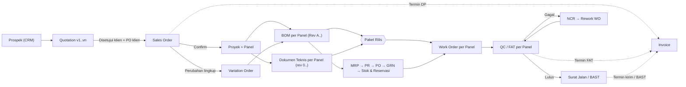

# Spesifikasi Alur Proses Bisnis Berantai (Document Chaining)
**Produk:** PanelERP — ERP & MES Manufaktur Panel Listrik
**Versi dokumen:** 1.0 · Oktober 2026
**Pendamping:** PRD v2.0 (dokumen ini mengatur *aturan proses*; PRD mengatur cakupan modul)
**Sasaran pembaca:** developer frontend/backend atau tool AI yang memperbaiki alur aplikasi

---

## 0. Ringkasan Singkat (baca ini dulu)

Frontend yang ada memperlakukan Quotation, Sales Order, BOM, Dokumen Teknis, Work Order, QC, dan Invoice sebagai **modul input mandiri**: pengguna membuat data satu per satu di tiap menu. Yang dibutuhkan adalah **alur berantai**: satu Proyek sebagai induk, dan setiap dokumen hilir **hanya dibuat dari dokumen hulu lewat tombol aksi**, mewarisi datanya, dan dijaga oleh syarat (gate) status.

Delapan aturan terpenting:

1. **Urutan utama:** Prospek → **Quotation** → **Sales Order** → Proyek/Panel → **BOM** → **Dokumen Teknis** → Paket Rilis → Produksi (WO) → **QC/FAT** → Pengiriman/BAST → **Invoice** (termin berbasis milestone).
2. **Dokumen hilir tidak punya tombol "+ Baru".** Ia dibuat lewat aksi "Buat … dari …" di dokumen hulu. Pengecualian hanya Prospek, Quotation, dan master data.
3. **Setiap dokumen menyimpan `project_id` dan `source_id`** (rujukan ke dokumen hulunya). Data hulu diwariskan, bukan diketik ulang.
4. **Tombol aksi hanya aktif jika syarat terpenuhi.** Jika tidak, tombol nonaktif dan menampilkan alasannya.
5. **Setelah disetujui, dokumen terkunci (read-only).** Koreksi lewat revisi (Rev B, versi n+1, ECN, atau Variation Order), bukan edit langsung.
6. **Harga dan lingkup SO dibekukan** (snapshot). Perubahan setelah SO Confirmed hanya lewat Variation Order.
7. **Invoice dibuat dari jadwal termin di SO** dan dipicu milestone (SO Confirmed, FAT Lulus, Pengiriman/BAST, akhir garansi), bukan diketik dari nol.
8. **Status proyek dihitung otomatis** dari status dokumen di bawahnya, tidak diubah manual.

---

## 1. Latar Belakang & Masalah

| Gejala di frontend sekarang | Akibatnya |
|---|---|
| Menu Quotation, SO, BOM, Dokumen Teknis, WO, QC, Invoice masing-masing punya form input sendiri | Data diketik berulang dan bisa saling bertentangan (mis. nama proyek, qty panel, nilai kontrak) |
| Tidak ada keterkaitan wajib antar dokumen | Invoice bisa dibuat tanpa FAT, BOM tanpa SO, QC untuk panel yang belum diproduksi |
| Status proyek di dashboard tidak punya aturan | Angka dashboard (kontrak aktif, progres, on-time) tidak bisa dipercaya |
| Tidak ada penguncian dan revisi | Dokumen yang sudah disetujui masih bisa diubah diam-diam; dampak ke hilir tidak terlihat |

---

## 2. Keputusan Desain

### 2.1 Quotation sebelum Sales Order
Permintaan awal menyebut urutan *Sales Order → Quotation*. Rekomendasi spesifikasi ini: **Quotation dulu, baru SO.**

- SO adalah komitmen kontrak (ada PO klien, harga disepakati, termin). SO tanpa harga yang disepakati membuat nilai kontrak dan dasar invoice tidak bisa dipercaya.
- Menu sidebar saat ini sudah menaruh Quotation sebelum Sales Order, jadi tidak perlu mengubah urutan menu, cukup menegakkan aturannya.
- Jika bisnis ingin ada catatan "order masuk" di awal, namai **Prospek/Inquiry** (sudah ada di menu CRM & Prospek), bukan Sales Order.
- **Repeat order / PO langsung tanpa quotation formal** ditangani sebagai pengecualian terkontrol (lihat 9.1).

### 2.2 "Paket Rilis" menjembatani BOM dan Dokumen Teknis
BOM dan Dokumen Teknis berjalan beriringan di dunia nyata (gambar memicu revisi BOM, dan sebaliknya). Agar urutan di sistem tetap berantai dan aman, produksi hanya boleh dibuka dari **Paket Rilis** = *BOM Approved* + *Dokumen wajib berstatus AFC* (Approved for Construction), per panel.

### 2.3 Invoice adalah turunan termin, bukan dokumen akhir tunggal
Termin pembayaran didefinisikan di SO. Saat milestone tercapai, termin menjadi "Siap Ditagih" dan Finance menerbitkan invoice dari termin tersebut.

### 2.4 Satu SO = satu Proyek (default)
SO Confirmed otomatis membuat satu Proyek. Variation Order mengubah SO dan Proyek yang sama, bukan membuat proyek baru.

---

## 3. Peta Alur



Garis putus-putus = pemicu milestone ke Invoice.

Ringkasan versi teks:

```
Prospek → Quotation (v1..vn) → [Disetujui klien + PO] → Sales Order → (Confirm) → Proyek + Panel
   → BOM (per panel) ─┐
   → Dokumen Teknis ──┴→ Paket Rilis → Work Order → QC/FAT → Surat Jalan/BAST
                                            ↑          ↓ gagal
              MRP→PR→PO→GRN→Stok ───────────┘      NCR → Rework
Termin SO ──milestone──► Invoice (DP · FAT · Kirim/BAST · Retensi)
```

---

## 4. Granularitas Dokumen

| Dokumen | Level | Catatan |
|---|---|---|
| Quotation | Prospek/klien; berisi banyak **baris panel** | Versi v1..vn |
| Sales Order | Kontrak; 1 SO = 1 Proyek | Perubahan via Variation Order |
| Proyek | Kontrak | Dibuat otomatis saat SO Confirmed |
| Panel | **Unit produksi, uji, dan serah terima** | Punya nomor panel dan nomor seri; berisi Section/Kubikel |
| BOM | Per Panel (baris dikelompokkan per Section) | Revisi Rev A, B, … |
| Dokumen Teknis | Per Panel (atau per Proyek untuk dokumen umum) | Revisi 0, 1, 2, … |
| Paket Rilis | Per Panel | Revisi mengikuti BOM/dokumen |
| Work Order | Per Panel (operasi sebagai baris) | Routing dari template |
| QC/FAT | Per Panel; percobaan ke-n | Percobaan ulang tertaut ke sebelumnya |
| Surat Jalan | Per pengiriman (boleh banyak panel; boleh parsial) | |
| Invoice | Per termin pada SO/Proyek | Tidak boleh melebihi nilai SO + VO |

---

## 5. Model Data Bersama

### 5.1 Kolom wajib di semua dokumen transaksi

| Kolom | Fungsi |
|---|---|
| `id`, `doc_no` | Identitas dan nomor tampilan (lihat bagian 12) |
| `project_id` | Proyek induk (kosong hanya untuk Prospek dan Quotation) |
| `source_type`, `source_id` | Dokumen hulu tempat dokumen ini dibuat (rujukan wajib) |
| `status` | Status saat ini sesuai state machine dokumen |
| `rev` / `version` | Nomor revisi/versi |
| `is_locked` | `true` bila sudah Approved/Terbit; mengunci edit |
| `superseded_by_id` | Revisi yang menggantikan (bila ada) |
| `created_by`, `created_at`, `approved_by`, `approved_at` | Jejak pembuatan dan persetujuan |
| `cancel_reason` | Wajib saat dibatalkan |

### 5.2 Relasi utama

```
Prospek 1─n Quotation(versi)
Quotation(versi terakhir, Disetujui) 1─1 SalesOrder
SalesOrder 1─1 Project
SalesOrder 1─n PaymentTerm            (termin → Invoice)
SalesOrder 1─n VariationOrder
Project    1─n Panel
Panel      1─n BOM(rev)               (hanya 1 rev aktif)
Panel      1─n TechDoc(tipe, rev)
Panel      1─n ReleasePackage(rev)    (hanya 1 rev aktif)
ReleasePackage 1─1 WorkOrder (aktif)  1─n WorkOrder rework
WorkOrder  1─n Inspection(FAT attempt)
Inspection 1─n NCR → ReworkWO
Panel      n─n DeliveryNote(Surat Jalan/BAST)
PaymentTerm 1─n Invoice
BOM        1─n PurchaseRequest → PurchaseOrder → GRN → StockLot
```

### 5.3 Log perpindahan status (wajib)

Tabel `status_log`: `doc_type`, `doc_id`, `from_status`, `to_status`, `action`, `by_user`, `at`, `reason`. Setiap transisi pada bagian 6–8 menulis satu baris.

---

## 6. Penjualan & Proyek

### 6.1 Quotation

**Dibuat dari:** Prospek (tombol "Buat Quotation"). Quotation adalah titik awal rantai; satu-satunya dokumen transaksi yang boleh dibuat mandiri (bersama Prospek).

**Isi:** header (klien, kontak, lokasi proyek, masa berlaku, term pembayaran, asumsi, pengecualian) dan **baris panel** (tipe panel/template, qty, spesifikasi ringkas, harga satuan). Setiap baris panel dapat membawa BOM estimasi (dari template atau item manual) yang menjadi titik awal BOM produksi nanti.

**Status & transisi**

| Dari | Ke | Aksi | Peran | Syarat | Efek |
|---|---|---|---|---|---|
| — | `DRAFT` | Buat Quotation | Sales | Prospek ada | Mewarisi klien, kontak, lokasi; nomor `QT-…-v1` |
| `DRAFT` | `MENUNGGU_APPROVAL` | Ajukan | Sales | Baris lengkap; margin < ambang atau diskon > batas | Notifikasi approver |
| `DRAFT` | `SIAP_KIRIM` | Finalisasi | Sales | Validasi lolos dan margin ≥ ambang | — |
| `MENUNGGU_APPROVAL` | `SIAP_KIRIM` / `DRAFT` | Setujui / Tolak | Direksi atau Manajer Sales | Alasan wajib bila tolak | — |
| `SIAP_KIRIM` | `TERKIRIM` | Kirim | Sales | Masa berlaku terisi | PDF di-snapshot; versi terkunci |
| `TERKIRIM` | `DRAFT` (versi n+1) | Revisi | Sales | — | Salin ke versi baru; versi lama menjadi `DIGANTIKAN` |
| `TERKIRIM` | `DISETUJUI_KLIEN` | Tandai Disetujui | Sales | — | Membuka aksi Konversi ke SO |
| `TERKIRIM` | `KALAH` | Tandai Kalah | Sales | Alasan wajib | Menutup prospek |
| `TERKIRIM` | `KEDALUWARSA` | (otomatis) | Sistem | Lewat masa berlaku | Dapat "Aktifkan Kembali" (membuat versi baru) |
| `DISETUJUI_KLIEN` | `MENJADI_SO` | Konversi ke SO | Admin Proyek | Guard 6.1.1 | SO draft dibuat; quotation terkunci permanen |

**6.1.1 Guard Konversi ke SO**
- Status `DISETUJUI_KLIEN` dan merupakan **versi terakhir** (bukan `DIGANTIKAN`).
- Masa berlaku belum lewat (atau override oleh Direksi dengan alasan).
- Tidak ada SO lain yang sudah dibuat dari quotation ini.

**Aturan:** hanya versi terakhir yang dapat dikirim atau disetujui. Versi lama selalu read-only dan bisa dibandingkan (diff) dengan versi terbaru.

**6.1.2 Estimasi HPP & Penetapan Harga Cost-Plus**

Quotation tidak lagi memakai nilai estimasi CRM sebagai harga. Setiap baris panel dihitung **bottom-up**:

1. **Biaya material** = Σ (qty item BOM template tipe panel × harga Item Master) × qty baris. (Sudah ada: `estimatePanelCost`.)
2. **Biaya jasa (services)** = Σ per operasi routing tipe panel (lihat 8.2):
   - operasi normal: `jam standar × qty baris × tarif rata-rata keahlian` (tarif = rata-rata `hourly_rate` karyawan **aktif** dengan keahlian tersebut; fallback: tarif default konfigurasi Settings);
   - operasi subkontrak: `biaya subcont per unit × qty baris` (harga vendor, bukan tarif karyawan).
3. **HPP baris** = material + jasa (+ overhead % konfigurasi bila > 0).
4. **Harga satuan cost-plus** = HPP × (1 + target margin%), dibulatkan sesuai konfigurasi pembulatan. Sales boleh **override** harga per baris — **wajib** mengisi alasan (`price_override_reason`), dicatat di log.
5. **Estimasi durasi perakitan** = total jam standar (semua baris, memperhitungkan operasi paralel) ÷ kapasitas harian keahlian (8.8), dalam **hari kerja** menurut kalender kerja; menghasilkan `est_days` dan `est_finish_date` dari asumsi tanggal mulai.
6. **Validasi terhadap CRM:** `crm_estimated_value` di-snapshot saat quotation dibuat. Deviasi |nilai penawaran − estimasi CRM| / estimasi CRM yang melebihi threshold konfigurasi (default 20%) memunculkan **peringatan** — Sales meninjau harga atau memperbarui nilai prospek. Estimasi CRM tetap jadi acuan potensi pasar, bukan dasar harga.
7. **Snapshot:** komputasi biaya di-snapshot pada saat quotation diajukan/dikirim (`cost_snapshot_at`); perubahan price list/routing berikutnya tidak mengubah dokumen terbit (aturan 9.6).

**Ringkasan alur harga:** Prospek (nilai indikatif) → **Baris panel + routing + kapasitas karyawan** → HPP + durasi → harga cost-plus (+ override beralasan) → guard margin → terbit.

### 6.2 Sales Order (SO)

**Dibuat dari:** Quotation `DISETUJUI_KLIEN` lewat tombol **"Konversi ke SO"**. Tidak ada tombol "+ SO Baru" (kecuali jalur pengecualian pada 9.1).

**Data yang diwariskan (tidak diketik ulang):** klien, kontak, lokasi proyek, seluruh baris panel (tipe, qty, spesifikasi), harga satuan dan total (dibekukan), BOM estimasi per baris, asumsi dan pengecualian, term pembayaran awal.

**Data yang wajib dilengkapi pada SO:** nomor PO klien + tanggal PO + lampiran PO, Project Manager, tanggal target pengiriman, jadwal termin (nama, persentase, **pemicu milestone**), persentase retensi dan masa garansi, apakah dokumen teknis perlu persetujuan klien (Ya/Tidak), dan alamat kirim.

**Field yang dapat diedit setelah Confirmed:** tanggal target kirim (tercatat di log), PIC klien, alamat kirim, catatan internal. **Tidak dapat diedit:** baris panel, qty, harga, nilai termin. Perubahan hal tersebut hanya lewat **Variation Order** (8.7).

**Status & transisi**

| Dari | Ke | Aksi | Peran | Syarat | Efek |
|---|---|---|---|---|---|
| — | `DRAFT` | Konversi dari Quotation | Admin Proyek | Guard 6.1.1 | Pra-isi dari quotation |
| `DRAFT` | `MENUNGGU_APPROVAL` | Ajukan | Admin Proyek | PO klien + lampiran, PM, jadwal termin (total 100%) | Notifikasi approver sesuai nilai |
| `MENUNGGU_APPROVAL` | `CONFIRMED` / `DRAFT` | Setujui / Tolak | Direksi atau PM sesuai matrix nilai | — | Memicu efek otomatis 6.2.1 |
| `CONFIRMED` | `BERJALAN` | (otomatis) | Sistem | Ada BOM/WO aktif | — |
| `CONFIRMED`/`BERJALAN` | `DITAHAN` | Tahan | Direksi | Alasan wajib | Reservasi dan PO baru ditahan |
| `BERJALAN` | `SELESAI` | (otomatis) | Sistem | Semua panel BAST dan semua termin terbit | — |
| `SELESAI` | `CLOSED` | Tutup | Finance | Piutang lunas dan retensi dilepas | Proyek ditutup |
| `DRAFT`–`CONFIRMED` | `DIBATALKAN` | Batalkan | Direksi | Guard 9.4 | Cascade pembatalan |

**6.2.1 Efek otomatis saat SO `CONFIRMED`**
1. Membuat **Proyek** `PRJ-…` (status turunan awal: Engineering) dengan PM sesuai SO.
2. Membuat **Panel** per baris × qty (`P01`, `P02`, …) beserta nomor seri.
3. Membuat **BOM Rev A (Draft)** per panel, berisi item dari BOM estimasi/template.
4. Membuat **shell Dokumen Teknis (Draft)** per panel sesuai daftar dokumen wajib untuk tipe panel tersebut.
5. Membuat jadwal **termin**; termin dengan pemicu "SO Confirmed" (umumnya DP) langsung `SIAP_DITAGIH` dan Finance menerima tugas.
6. Mengirim notifikasi ke PM, Manajer Teknik, dan Finance.
7. Menandai quotation sumber `MENJADI_SO` (terkunci).

### 6.3 Proyek

**Dibuat dari:** SO `CONFIRMED` (otomatis). Tidak dibuat manual. Tombol "+ Proyek Baru" pada header dashboard dialihkan menjadi "Buat Quotation / Prospek Baru".

**Status proyek dihitung otomatis** dari status panel, bukan dipilih manual:

| Status proyek | Aturan turunan |
|---|---|
| `ENGINEERING` | SO Confirmed; belum ada Paket Rilis pada panel mana pun, atau dokumen/BOM masih Draft/Review |
| `MENUNGGU_PERSETUJUAN_GAMBAR` | Ada dokumen teknis berstatus dikirim ke klien dan belum AFC |
| `SIAP_PRODUKSI` | Paket Rilis ada, WO belum berjalan |
| `PRODUKSI` | Ada WO berjalan |
| `QC_FAT` | Ada panel dalam pengujian |
| `SIAP_KIRIM` / `TERKIRIM` | Panel FAT Lulus menunggu kirim / sebagian atau seluruhnya terkirim |
| `BAST` | BAST terbit |
| `GARANSI` | Masa garansi berjalan |
| `DITUTUP` | SO `CLOSED` |
| `DITAHAN` / `DIBATALKAN` | Mengikuti SO |

Karena proyek berisi banyak panel, tampilkan **tahap terendah di antara panel aktif** sebagai status utama, dan rincian "n panel di tahap lain" sebagai keterangan. Progres % dihitung berbobot dari jam standar operasi yang selesai (lihat PRD FR-6.11).

**Halaman Proyek adalah pusat kerja:** stepper alur, tab dokumen terkait, tombol aksi utama (lihat bagian 13).

---

## 7. Engineering

### 7.1 BOM (Bill of Materials)

**Dibuat dari:** Panel pada Proyek. **Rev A dibuat otomatis (Draft)** saat SO Confirmed, dengan item dari BOM estimasi/template. Engineer melengkapi dan merevisi; tidak ada form "BOM baru" tanpa panel.

**Aksi bantu:** "Salin dari template panel" dan "Salin dari proyek lama" (hanya mengisi baris; tidak membuat dokumen tanpa panel).

**Status & transisi**

| Dari | Ke | Aksi | Peran | Syarat | Efek |
|---|---|---|---|---|---|
| — | `DRAFT` | (otomatis dari SO) | Sistem | SO Confirmed | Rev A |
| `DRAFT` | `IN_REVIEW` | Ajukan Review | Engineer | Semua baris terhubung ke Item Master, qty > 0, UoM valid | Notifikasi Manajer Teknik |
| `IN_REVIEW` | `APPROVED` / `DRAFT` | Setujui / Kembalikan | Manajer Teknik | Alasan wajib bila dikembalikan | BOM **terkunci**; memicu MRP (8.1) dan reservasi stok |
| `APPROVED` | `SUPERSEDED` | (otomatis) | Sistem | Rev baru berstatus Approved | Rev lama read-only; rujukan hilir pindah ke rev baru |
| `APPROVED` | `DRAFT` (Rev n+1) | Buat Revisi | Engineer | Alasan revisi wajib | Menyalin BOM ke Rev berikutnya; BOM lama tetap berlaku sampai Rev baru Approved |

**Guard khusus**
- BOM tidak dapat diajukan jika ada baris tanpa Item Master (kode bebas dilarang).
- Total qty panel di BOM harus sesuai panel pada SO (BOM selalu per panel, tidak boleh membuat panel baru).
- **Approve Rev B** menjalankan **analisis dampak** (lihat 9.3): daftar PO terbuka, barang yang sudah diterima, stok yang dicadangkan, material yang sudah di-picking atau terpasang, dan WO yang berjalan. Persetujuan hanya bisa dilakukan setelah analisis ditampilkan dan dikonfirmasi.

### 7.2 Dokumen Teknis

**Dibuat dari:** Panel. Shell dokumen dibuat otomatis (Draft) saat SO Confirmed sesuai daftar dokumen wajib untuk tipe panel (default: SLD, Layout/GA, Wiring Diagram; Datasheet komponen utama opsional). Engineer mengunggah file pada shell, tidak membuat dokumen tanpa panel.

**Status & transisi** (per dokumen, per revisi)

| Dari | Ke | Aksi | Peran | Syarat | Efek |
|---|---|---|---|---|---|
| `DRAFT` | `REVIEW_INTERNAL` | Ajukan Review | Engineer | File terunggah; rev terisi | Notifikasi Manajer Teknik |
| `REVIEW_INTERNAL` | `DIKIRIM_KLIEN` | Setujui & Kirim ke Klien | Manajer Teknik | SO menandai "perlu persetujuan klien" = Ya | Muncul di portal klien |
| `REVIEW_INTERNAL` | `AFC` | Setujui | Manajer Teknik | SO menandai "perlu persetujuan klien" = Tidak | Dokumen dikunci |
| `DIKIRIM_KLIEN` | `AFC` | Disetujui klien | PM (atau klien via portal) | — | Dokumen dikunci |
| `DIKIRIM_KLIEN` | `DRAFT` (rev n+1) | Revisi / Ditolak | PM | Komentar klien wajib dicatat | Rev baru; BOM mungkin perlu direvisi |
| `AFC` | `DIGANTIKAN` | (otomatis) | Sistem | Rev baru AFC | — |

`AFC` = *Approved for Construction*. **Dokumen yang berstatus `AFC` tidak dapat diedit**; perubahan hanya lewat revisi baru, yang memberi tanda "perlu ditinjau" pada Paket Rilis, WO, dan QC yang memakai revisi lama.

**Aturan sinkronisasi dengan BOM:** bila dokumen teknis direvisi dan mengubah komponen, sistem meminta pengguna membuat BOM Rev baru (ECN) dari halaman dokumen tersebut; hanya pengingat dan tautan, bukan perubahan otomatis.

### 7.3 Paket Rilis Produksi

**Dibuat dari:** Panel, lewat tombol **"Rilis ke Produksi"** (hanya Manajer Teknik).

**Syarat aktif tombol:**
1. BOM panel berstatus `APPROVED`.
2. Semua dokumen wajib untuk tipe panel berstatus `AFC`.
3. Tidak ada ECN terbuka pada panel tersebut.

**Isi paket:** referensi `bom_rev`, daftar `tech_doc_rev` yang berlaku, tanggal rilis, dan pengguna perilis.

**Status:** `DIRILIS` → `DIGANTIKAN` (bila Paket Rilis Rev baru dibuat setelah revisi BOM/dokumen).

**Efek saat dirilis:**
1. Status panel menjadi `SIAP_PRODUKSI`.
2. **Work Order** (Draft) dibuat untuk panel tersebut dari template routing (8.2).
3. Pengecekan ketersediaan material (hijau/kuning/merah) dijalankan untuk WO.
4. Teknisi/tablet hanya melihat revisi dokumen yang tercantum pada paket ini.

**Aturan:** Work Order **tidak dapat dibuat atau dirilis tanpa Paket Rilis** (kecuali jalur pengecualian terdokumentasi pada 9.1).

---

## 8. Eksekusi, Mutu, Pengiriman & Penagihan

### 8.1 Pengadaan & Stok (cabang otomatis dari BOM)

Menu Pembelian dan Inventaris berfungsi sebagai **antrean kerja**, bukan form kosong.

| Dokumen | Dibuat dari | Pemicu | Guard utama |
|---|---|---|---|
| **MRP Run** | BOM `APPROVED` (per panel) | Otomatis saat BOM Approved/direvisi | Hanya BOM Approved; hasil: kebutuhan bruto, stok tersedia, PO terbuka, kebutuhan bersih (dengan konversi UoM) |
| **Reservasi stok** | Hasil MRP | Otomatis untuk stok tersedia | Terikat ke panel; tidak boleh melebihi stok tersedia; stok minus ditolak |
| **Purchase Request (PR)** | Hasil MRP | Otomatis (Draft) | PR manual hanya boleh dengan `project_id` **atau** bertanda "Stok Umum" (reorder point); approval berjenjang sesuai nilai |
| **Purchase Order (PO)** | PR yang disetujui (RFQ opsional) | Aksi "Buat PO" | Setiap baris PO menunjuk baris PR; PO tanpa PR hanya untuk jasa subkontrak yang dibuat dari operasi WO |
| **GRN (penerimaan)** | PO | Aksi "Terima Barang" | **Wajib dari PO**; qty ≤ qty PO (+ toleransi konfigurasi); lot/serial wajib untuk item berflag; barang berflag IQC masuk karantina |
| **IQC** | Baris GRN | Otomatis untuk item berflag | Barang karantina tidak boleh dicadangkan atau di-picking sebelum lulus |
| **Picking List** | WO yang dirilis | Otomatis | Urut lokasi bin; konfirmasi dengan scan |
| **Material Issue** | Picking List | Konfirmasi scan | Qty ≤ reservasi/BOM; ambil di luar BOM wajib alasan + approval Manajer Produksi |
| **Material Return** | Material Issue | Aksi "Kembalikan" | Hanya dari issue yang ada; stok kembali ke proyek/umum sesuai pilihan |

Item *long-lead* ditandai di BOM; pengadaan dini sebelum BOM Approved hanya lewat jalur pengecualian 9.1(b).

### 8.2 Work Order (WO)

**Dibuat dari:** Paket Rilis (otomatis Draft saat paket dirilis). Satu WO aktif per panel. Tidak ada tombol "+ WO Baru".

**Operasi** diambil dari template routing untuk tipe panel (default: Fabrikasi → Pengecatan/Subkontrak → Rakit Mekanis → Wiring → Test), dengan **jam standar per operasi** (tabel `routing_operations`, PRD §3.1). Template routing yang sama adalah sumber estimasi biaya jasa, man-hours, dan durasi pada Quotation (6.1.2); WO mewarisi `estimated_manhours` & target due date dari estimasi tersebut.

**Status WO:** `DRAFT` → `DIRILIS` → `BERJALAN` → `SELESAI` (atau `DIBATALKAN`). **Status operasi:** `MENUNGGU` → `BERJALAN` ⇄ `JEDA` → `SELESAI`.

| Aksi | Syarat | Efek |
|---|---|---|
| Rilis WO | Paket Rilis aktif; ketersediaan material **hijau** (lengkap) atau **kuning** (sebagian, dengan peringatan); **merah** memblokir | Picking List dibuat; WO tampil di tablet |
| Mulai operasi | Operasi sebelumnya `SELESAI` (kecuali ditandai paralel) | Time tracking berjalan |
| Selesaikan operasi | Hold point IPQC pada operasi tersebut (bila ada) lulus | Progres panel diperbarui |
| Selesaikan WO | Semua operasi `SELESAI` dan semua material issue terkonfirmasi | Panel berstatus `SIAP_QC`; tombol "Mulai FAT" aktif |

**Rework WO** dibuat dari NCR (8.3), tertaut ke WO induk, dan biayanya dicatat terpisah. Operasi bertanda subkontrak menghasilkan PO jasa yang tertaut ke operasi tersebut.

### 8.3 QC, FAT & NCR

| Jenis | Dibuat dari | Catatan |
|---|---|---|
| **IQC** | Baris GRN berflag | Hasil lulus/tolak; menentukan status karantina |
| **IPQC** | Hold point pada operasi WO | Operasi tidak bisa selesai sebelum hold point lulus |
| **FAT** | WO `SELESAI` → tombol **"Mulai FAT"** | Per panel; percobaan ke-n |
| **NCR** | Butir pemeriksaan yang gagal | Wajib punya inspeksi sumber; foto dari tablet |

**FAT mewarisi (tidak diketik ulang):** nomor panel dan nomor seri, daftar komponen terpasang beserta lot/serial (dari Material Issue), revisi dokumen yang berlaku (dari Paket Rilis), template uji sesuai tipe panel dan standar yang dipilih, serta daftar alat uji.

**Status FAT:** `DIJADWALKAN` → `BERJALAN` → `LULUS` / `LULUS_DENGAN_CATATAN` (punch list) / `GAGAL`.

**Guard FAT**
- Alat uji yang dipilih harus berkalibrasi aktif; alat kedaluwarsa ditolak.
- `LULUS` tidak bisa ditetapkan jika ada parameter gagal atau **NCR mayor terbuka**.
- Hasil FAT yang sudah selesai **tidak dapat diubah**; uji ulang dibuat sebagai percobaan baru yang tertaut ke percobaan sebelumnya.
- FAT bersaksi: penjadwalan dan konfirmasi kehadiran klien/konsultan, tanda tangan digital saksi.
- `LULUS`/`LULUS_DENGAN_CATATAN` menerbitkan **Sertifikat/Laporan FAT** (PDF) otomatis.

**Alur gagal:** `GAGAL` → NCR → disposisi → Rework WO → FAT percobaan baru.

**Status NCR:** `TERBUKA` → `DISPOSISI` → `TINDAKAN` → `VERIFIKASI` → `TERTUTUP`. Disposisi: rework, repair, scrap, atau use-as-is; use-as-is dan scrap memerlukan persetujuan Manajer Teknik dan Manajer Produksi.

### 8.4 Pengiriman & BAST

| Dokumen | Dibuat dari | Guard | Efek |
|---|---|---|---|
| **Surat Jalan** | Panel berstatus FAT `LULUS`/`LULUS_DENGAN_CATATAN` | Hanya panel yang lulus FAT dan punch list kritis selesai; mendukung pengiriman parsial | Status panel `TERKIRIM` setelah bukti terima |
| **BAST** | Surat Jalan `DITERIMA` (atau hasil commissioning bila ada) | Tanda tangan digital kedua pihak | Memicu termin `BAST_SIGNED` dan memulai masa garansi |

### 8.5 Invoice & Termin

**Termin (`PaymentTerm`) didefinisikan di SO.** Setiap termin: nama, persentase, **pemicu**, dan cakupan.

| Pemicu (`trigger_event`) | Terjadi saat |
|---|---|
| `SO_CONFIRMED` | SO Confirmed (umumnya DP) |
| `FAT_PASSED` | FAT Lulus (cakupan `SEMUA_PANEL` atau `PER_PANEL`) |
| `DELIVERED` | Surat Jalan diterima |
| `BAST_SIGNED` | BAST ditandatangani |
| `WARRANTY_END` | Masa garansi berakhir (pelepasan retensi) |
| `TANGGAL_TETAP` | Tanggal tertentu |

Contoh jadwal termin (nilai default konfigurasi): DP 30% (`SO_CONFIRMED`), FAT 50% (`FAT_PASSED`, semua panel), Pengiriman 20% (`DELIVERED`).

**Status termin:** `BELUM_JATUH_TEMPO` → `SIAP_DITAGIH` (otomatis saat pemicu terjadi) → `DITAGIH` → `LUNAS`.

**Invoice dibuat dari termin `SIAP_DITAGIH`** lewat aksi "Terbitkan Invoice" (Finance); form sudah terisi nilai, PPN, retensi, dan acuan SO.

| Dari | Ke | Aksi | Syarat |
|---|---|---|---|
| — | `DRAFT` | Terbitkan dari termin | Termin `SIAP_DITAGIH` |
| `DRAFT` | `MENUNGGU_APPROVAL` | Ajukan | Nilai di atas batas approval |
| `DRAFT`/`MENUNGGU_APPROVAL` | `TERBIT` | Terbitkan | Total invoice ≤ nilai SO + VO disetujui |
| `TERBIT` | `DIBAYAR_SEBAGIAN` / `LUNAS` | Catat pembayaran | — |
| `TERBIT` | `VOID` | Nota kredit | Alasan wajib; invoice tidak pernah dihapus |

**Guard:** nilai invoice tidak boleh melebihi nominal termin; total seluruh invoice tidak boleh melebihi nilai SO + VO disetujui; invoice yang sudah `TERBIT` read-only (koreksi lewat nota kredit).

### 8.6 Retensi & Garansi

- Persentase retensi dan masa garansi diisi di SO.
- Retensi ditahan dari nilai tiap invoice dan dicatat sebagai piutang tertahan.
- Melepas retensi lewat termin `RETENSI` berpemicu `WARRANTY_END` yang tetap menjadi invoice dari termin.
- Garansi dimulai saat `BAST_SIGNED`; pengingat dikirim sebelum berakhir.

### 8.7 Variation Order (VO)

**Dibuat dari:** SO `CONFIRMED`/`BERJALAN` lewat tombol **"Ajukan Perubahan"**. Ini satu-satunya cara mengubah lingkup, qty, atau harga setelah SO dikonfirmasi.

**Isi VO:** alasan, lampiran permintaan klien, baris perubahan (tambah/ubah/hapus panel, section, atau item), selisih harga, selisih jadwal.

**Status:** `DRAFT` → `MENUNGGU_APPROVAL_INTERNAL` → `DIKIRIM_KLIEN` → `DISETUJUI` → `DITERAPKAN` (atau `DITOLAK` / `DIBATALKAN`).

**Guard:** VO tidak dapat `DITERAPKAN` tanpa bukti persetujuan klien (lampiran atau persetujuan di portal).

**Efek saat `DITERAPKAN`**
1. Nilai kontrak diperbarui (nilai SO + total VO disetujui) dan tampil di dashboard.
2. Panel baru dibuat bila ada (dengan BOM Rev A dan shell dokumen).
3. Panel terdampak mendapat tugas **BOM Rev baru** dan **revisi dokumen**; analisis dampak 9.3 berjalan.
4. Jadwal termin diperbarui: VO menambah termin khusus dengan pemicu yang ditentukan di VO.
5. Notifikasi ke PM, Manajer Teknik, Finance, dan Purchasing.

### 8.8 Manajemen Ketersediaan Karyawan

**Tujuan:** menyediakan data kapasitas tenaga kerja workshop yang valid untuk (a) estimasi biaya jasa & durasi pada Quotation (6.1.2), dan (b) perencanaan WO. Modul ini bersifat **kapasitas dasar** — bukan penjadwalan finit multi-proyek.

**Master data** (PRD §3.1): `employees` (nama, jabatan, **keahlian** — Fabrikasi / Powder Coating / Rakit Mekanis / Wiring / QC, **tarif/jam**, jam kerja/hari, status aktif), `employee_absences` (cuti/sakit/izin/tugas luar dengan rentang tanggal), `work_calendar` (hari kerja & libur nasional).

**Rumus kapasitas (per keahlian, per tanggal):**

```
kapasitas_harian(skill, tanggal) = Σ karyawan aktif dengan skill tersebut
                                   yang tidak sedang absen & tanggal adalah hari kerja
                                   (work_hours_per_day masing-masing)
```

**Pemakaian:**
1. **Estimasi Quotation (6.1.2)** — durasi & tarif rata-rata dihitung dari kapasitas & tarif aktual karyawan; keahlian tanpa karyawan aktif → peringatan "kapasitas nol" dan estimator memakai tarif default konfigurasi.
2. **Perencanaan WO (8.2)** — due date WO di-set dari estimasi durasi quotation; bila kapasitas berubah drastis (banyak absensi), Manajer Produksi meninjau ulang jadwal.
3. **Timesheet (8.2)** — `employee_id` pada timesheet menopang analisis realisasi vs jam standar (tahap lanjutan).

**Peran (RBAC §11):** Admin/Manajer Produksi mengelola karyawan, absensi, dan kalender; Manajer Produksi mengelola template routing & jam standar; Sales & Estimator hanya **membaca** kapasitas untuk estimasi.

**Default konfigurasi (Settings):** hari kerja Senin–Sabtu, 8 jam/hari, tarif default per keahlian (fallback), overhead %, pembulatan harga, threshold deviasi CRM (20%).

---

## 9. Aturan Lintas Tahap & Kasus Khusus

### 9.1 Jalur Pengecualian Terkontrol
Setiap pengecualian wajib beralasan, tercatat di `status_log`, dan muncul di laporan "Pengecualian".

| Kode | Pengecualian | Siapa | Cara kerja |
|---|---|---|---|
| (a) | **SO langsung tanpa quotation** (repeat order / PO langsung) | Admin Proyek + persetujuan Direksi | SO dibuat dengan sumber `PO_LANGSUNG`; sistem membuat quotation internal otomatis agar rantai tetap utuh |
| (b) | **Pengadaan dini** untuk item *long-lead* sebelum BOM Approved | Purchasing/PM + persetujuan Direksi atau Finance | PR bertanda `early_procurement`; badge risiko "Belum AFC" tampil di PR/PO |
| (c) | **Rilis bersyarat** (mulai fabrikasi sebelum semua dokumen AFC) | Manajer Teknik + persetujuan PM/Direksi | Hanya operasi fabrikasi yang dibuka; operasi berikutnya tetap terblokir sampai Paket Rilis lengkap |
| (d) | **Override masa berlaku quotation** saat konversi ke SO | Direksi | Alasan wajib |

### 9.2 Penguncian & Cara Koreksi

| Dokumen | Terkunci saat | Cara koreksi |
|---|---|---|
| Quotation | `TERKIRIM` | Revisi → versi n+1 |
| Sales Order | `CONFIRMED` | Variation Order |
| BOM | `APPROVED` | Rev baru (+ ECN) |
| Dokumen Teknis | `AFC` / dikirim ke klien | Revisi baru |
| Paket Rilis | `DIRILIS` | Paket revisi baru |
| Work Order | `DIRILIS` | Penyesuaian operasi oleh Manajer Produksi dengan log; perubahan material mengikuti BOM Rev |
| FAT | `LULUS`/`GAGAL` (selesai) | Percobaan baru; hasil lama tidak diubah |
| Invoice | `TERBIT` | Nota kredit |

Dokumen terkunci menampilkan banner **"Dokumen ini terkunci"** dengan tombol **"Buat Revisi"** (bila boleh).

### 9.3 Analisis Dampak Revisi (BOM/Dokumen/VO)
Sebelum Rev baru disetujui, sistem menampilkan dampak ke hilir dan membuat tugas otomatis:

| Kondisi material/pekerjaan | Tindakan sistem |
|---|---|
| Item dihapus/diubah, belum dibeli | Dihapus dari MRP; reservasi dilepas |
| PR/PO terbuka, belum diterima | Tugas ke Purchasing: revisi atau batalkan PO |
| Sudah diterima/di stok | Reservasi dipindah/dilepas; opsi masuk stok umum atau retur ke vendor |
| Sudah dicadangkan | Reservasi lama dilepas, reservasi baru dibuat |
| Sudah di-picking/issue, belum terpasang | Tugas Material Return ke Gudang |
| Sudah terpasang | WO Rework wajib; biaya dicatat sebagai varians perubahan |
| WO berjalan | WO ditandai "perlu ditinjau"; Manajer Produksi memutuskan |

### 9.4 Pembatalan
- **Tidak ada penghapusan** dokumen transaksi; hanya `DIBATALKAN` dengan alasan.
- Dokumen yang masih punya **turunan aktif** tidak dapat dibatalkan; batalkan turunan terlebih dahulu (urutan dari hilir ke hulu).
- **Batal SO:** belum ada PO/produksi → pembatalan langsung (cascade: BOM Draft, shell dokumen, reservasi dibatalkan/dilepas). Sudah ada PO/GRN → perlu Direksi dan tindak lanjut PO. Sudah produksi → tidak dapat dibatalkan; hanya penghentian/terminasi dengan perhitungan biaya yang sudah keluar (diproses terpisah).

### 9.5 Guard Kuantitas & Nilai

| Aturan | Ditegakkan pada |
|---|---|
| Jumlah panel di BOM/WO/FAT ≤ panel pada SO + VO | Pembuatan dokumen |
| Total invoice ≤ nilai SO + VO disetujui; per invoice ≤ nominal termin | Penerbitan invoice |
| Qty GRN ≤ qty PO (+ toleransi) | GRN |
| Qty material issue ≤ reservasi/BOM, kecuali ambil di luar BOM dengan approval | Material Issue |
| Surat Jalan hanya untuk panel FAT Lulus | Surat Jalan |
| Reservasi ≤ stok tersedia; stok tidak boleh minus | Reservasi/issue |

### 9.6 Snapshot Data Hulu
Setelah dokumen hulu terkunci, perubahan data master (mis. nama klien, harga price list) **tidak mengubah** dokumen yang sudah terbit. Harga SO tetap sesuai quotation yang disetujui; pembaruan price list hanya berlaku untuk quotation/BOM estimasi baru.

---

## 10. Matriks Gate (Syarat Setiap Aksi)

Tombol aksi **nonaktif** dan menampilkan pesan (bagian 14) jika syarat tidak terpenuhi. Validasi yang sama wajib ditegakkan di backend (jangan hanya di UI).

| Kode | Aksi | Syarat yang harus terpenuhi |
|---|---|---|
| G01 | Konversi Quotation → SO | Quotation `DISETUJUI_KLIEN`, versi terakhir, belum menjadi SO, masa berlaku belum lewat (atau override) |
| G02 | Ajukan SO | No. PO klien + tanggal + lampiran; PM ditunjuk; jadwal termin total 100%; alamat kirim terisi |
| G03 | Confirm SO | Persetujuan sesuai approval matrix nilai |
| G04 | Ajukan Review BOM | Semua baris terhubung Item Master; qty > 0; UoM valid |
| G05 | Approve BOM | Peran Manajer Teknik; analisis dampak sudah ditampilkan dan dikonfirmasi (untuk Rev B dst.) |
| G06 | Rilis ke Produksi | BOM `APPROVED`; semua dokumen wajib `AFC`; tidak ada ECN terbuka |
| G07 | Rilis WO | Paket Rilis aktif; ketersediaan material tidak merah |
| G08 | Mulai operasi WO | Operasi sebelumnya `SELESAI` (kecuali paralel); WO `DIRILIS`/`BERJALAN` |
| G09 | Mulai FAT | WO panel `SELESAI`; semua hold point IPQC lulus |
| G10 | Tetapkan FAT Lulus | Semua parameter lulus; tidak ada NCR mayor terbuka; alat uji berkalibrasi aktif |
| G11 | Buat Surat Jalan | Panel FAT `LULUS`/`LULUS_DENGAN_CATATAN`; punch list kritis selesai |
| G12 | Terbitkan Invoice | Termin `SIAP_DITAGIH`; nilai ≤ nominal termin; total invoice ≤ nilai SO + VO |
| G13 | Batalkan dokumen | Tidak ada dokumen turunan aktif; alasan terisi |
| G14 | Terapkan VO | VO `DISETUJUI` dengan bukti persetujuan klien |

---

## 11. Hak Akses per Aksi (RBAC)

| Aksi | Peran yang diizinkan |
|---|---|
| Buat/ubah Prospek, buat/revisi/kirim Quotation | Sales & Estimator |
| Setujui Quotation (margin/diskon di bawah ambang) | Direksi, Manajer Sales |
| Konversi ke SO, lengkapi SO | Admin Proyek |
| Setujui/Confirm SO | Direksi, Project Manager (sesuai nilai) |
| Lengkapi dan revisi BOM, unggah dokumen teknis | Engineer / Drafter |
| Setujui BOM, setujui dokumen, Rilis ke Produksi | Manajer Teknik |
| Setujui dokumen yang dikirim ke klien | Project Manager (atau klien via portal) |
| PR, RFQ, PO | Purchasing |
| Setujui PR/PO | Sesuai nilai (approval matrix) |
| GRN, picking, opname, retur | Staf Gudang |
| Rilis WO, atur routing/jadwal, setujui ambil di luar BOM | Manajer Produksi |
| Kelola master karyawan, absensi (cuti/sakit/izin), kalender kerja | Admin, Manajer Produksi |
| Ubah template routing & jam standar operasi | Manajer Produksi |
| Lihat kapasitas & tarif (untuk estimasi) | Sales & Estimator (read-only) |
| Jalankan operasi WO (tablet) | Teknisi |
| IQC/IPQC/FAT, NCR | QC / Inspector |
| Setujui disposisi use-as-is/scrap | Manajer Teknik + Manajer Produksi |
| Surat Jalan, BAST | Logistik (BAST: persetujuan PM) |
| Terbitkan invoice, catat pembayaran, nota kredit | Finance |
| Ajukan VO | Project Manager |
| Jalur pengecualian 9.1 | Sesuai tabel 9.1 |
| Lihat status, setujui gambar/VO (portal) | Klien/Konsultan |

Tombol aksi **tidak ditampilkan** untuk peran yang tidak berwenang (bukan sekadar nonaktif).

---

## 12. Penomoran Dokumen

| Dokumen | Format | Contoh |
|---|---|---|
| Prospek | `LD-{tahun}-{urut}` | `LD-2026-014` |
| Quotation | `QT-{tahun}-{urut}-v{n}` | `QT-2026-031-v3` |
| Sales Order | `SO-{tahun}-{urut}` | `SO-2026-018` |
| Proyek | `PRJ-{tahun}-{urut}` | `PRJ-2026-003` |
| Panel | `{PRJ}-P{nn}` | `PRJ-2026-003-P01` |
| BOM | `BOM-{panel}-Rev{A..}` | `BOM-PRJ-2026-003-P01-RevA` |
| Dokumen Teknis | `DWG-{panel}-{tipe}-R{n}` | `DWG-PRJ-2026-003-P01-SLD-R1` |
| Paket Rilis | `REL-{panel}-R{n}` | `REL-PRJ-2026-003-P01-R1` |
| Work Order | `WO-{panel}` (rework: `WO-{panel}-RW{n}`) | `WO-PRJ-2026-003-P01` |
| FAT | `FAT-{panel}-#{percobaan}` | `FAT-PRJ-2026-003-P01-#1` |
| NCR | `NCR-{tahun}-{urut}` | `NCR-2026-045` |
| Variation Order | `{SO}-VO{nn}` | `SO-2026-018-VO01` |
| Surat Jalan / BAST | `SJ-{tahun}-{urut}` / `BAST-{tahun}-{urut}` | `SJ-2026-022` |
| Invoice | `INV-{tahun}-{urut}` | `INV-2026-040` |

Nomor dokumen hilir memuat nomor proyek/panel agar rantai terbaca dari nomornya saja.

---

## 13. Spesifikasi UI/UX

### 13.1 Perubahan Menu Sidebar

| Menu | Perilaku baru |
|---|---|
| Master Data (Item Master, Vendor, Pelanggan) | Tetap, boleh "+ Baru" |
| CRM & Prospek | Tetap, boleh "+ Baru" |
| Quotation | Daftar versi; "+ Baru" hanya dari halaman Prospek; modal kalkulator **cost-plus** (material + jasa + durasi + deviasi CRM) |
| Karyawan & Kapasitas (baru) | Master karyawan/keahlian/tarif, catat absensi, kartu kapasitas harian per keahlian |
| Sales Order | **Daftar saja**; dibuat lewat "Konversi ke SO" di Quotation (tanpa tombol "+ Baru") |
| Semua Proyek | **Daftar saja**; klik masuk ke Halaman Proyek |
| Bill of Materials | Daftar BOM per panel; tanpa tombol "+ Baru" |
| Dokumen Teknis | Daftar dokumen per panel; unggah file pada shell yang sudah ada |
| Stok & Gudang | Stok, opname, transfer; penerimaan hanya dari PO |
| Penerimaan (GRN) | **Antrean "PO menunggu diterima"**; tombol "Terima" di baris PO |
| PR & Purchase Order | PR otomatis dari MRP; PR manual hanya "Stok Umum"; PO dari PR |
| Work Order | **Antrean**; WO dibuat dari Paket Rilis |
| Template Routing (baru) | Tabel operasi & jam standar per tipe panel; rekap biaya jasa & durasi per panel |
| QC & NCR & FAT | **Antrean "Siap FAT"** dan daftar inspeksi; NCR dari butir gagal |
| Invoice & AR/AP | **Antrean "Siap Ditagih"** dan daftar invoice |
| Pengiriman & BAST (baru) | Antrean "Siap Kirim" dan daftar BAST |
| Variation Order (baru) | Daftar VO lintas proyek; dibuat dari SO |

Tombol header **"+ Proyek Baru"** diganti menjadi **"+ Prospek / Quotation Baru"**.

Setiap menu hilir menyediakan filter **"Menunggu tindakan saya"** dan **"Terblokir"**.

### 13.2 Halaman Proyek (pusat kerja)

**Stepper alur** di bagian atas (level proyek), dengan tahap:

`Quotation → SO → BOM → Dok. Teknis → Rilis → Produksi → QC/FAT → Kirim/BAST → Invoice`

| Keadaan tahap | Tampilan | Arti |
|---|---|---|
| `SELESAI` | ✓ hijau | Seluruh panel melewati tahap ini |
| `AKTIF` | ● biru | Sedang berjalan |
| `MENUNGGU` | ○ abu | Belum bisa dimulai |
| `TERBLOKIR` | 🔒 merah + alasan | Gate tidak terpenuhi |
| `PERLU_TINJAU` | ⚠ kuning | Revisi hulu terjadi, hilir perlu ditinjau |

**Tabel panel** di dalam halaman proyek: baris per panel dengan mini-stepper per panel (BOM · Dok · Rilis · WO · FAT · Kirim) dan aksi per baris.

**Tab dokumen terkait:** Quotation, SO, Variation Order, BOM, Dokumen Teknis, Pengadaan, Work Order, QC, Pengiriman/BAST, Invoice & Termin, Log aktivitas.

### 13.3 Tombol Aksi Utama (satu per tahap)

| Lokasi | Label tombol | Aktif jika (gate) |
|---|---|---|
| Quotation | "Konversi ke SO" | G01 |
| SO | "Ajukan / Confirm SO" | G02 / G03 |
| Panel · BOM | "Ajukan Review" / "Setujui BOM" | G04 / G05 |
| Panel · Dokumen | "Ajukan Review" / "Kirim ke Klien" | File terunggah |
| Panel | "Rilis ke Produksi" | G06 |
| Panel · WO | "Rilis WO" | G07 |
| Panel · WO | "Mulai FAT" | G09 |
| Panel · FAT | "Tetapkan Lulus" | G10 |
| Panel / Pengiriman | "Buat Surat Jalan" | G11 |
| Termin | "Terbitkan Invoice" | G12 |
| SO | "Ajukan Perubahan (VO)" | SO `CONFIRMED`/`BERJALAN` |

Tombol nonaktif menampilkan **alasan** dalam tooltip atau teks kecil di bawah tombol (mis. "BOM belum disetujui").

### 13.4 Halaman Dokumen
Setiap halaman dokumen (BOM, WO, FAT, Invoice, dst.) memuat:
- **Breadcrumb rantai:** `QT-2026-031-v3 › SO-2026-018 › PRJ-2026-003 › P01 › BOM Rev A` (setiap bagian dapat diklik).
- **Panel "Dokumen Terkait":** daftar dokumen hulu dan hilir berikut statusnya.
- **Banner "Dokumen ini terkunci"** dengan tombol "Buat Revisi" (bila boleh).
- **Banner "Perlu ditinjau"** bila hulunya direvisi, berisi ringkasan dampak (mis. "BOM Rev B menggantikan Rev A: 2 PO terbuka, 1 WO berjalan").
- **Timeline status** dari `status_log` (siapa, kapan, alasan).

### 13.5 Dashboard
- Tabel **Proyek Aktif**: tambah kolom **"Tahap Saat Ini"** dan **"Hambatan"** (alasan terblokir/perlu tinjau); status berasal dari status turunan (6.3).
- **Total Kontrak Aktif** = jumlah nilai SO berstatus `CONFIRMED`/`BERJALAN` + VO yang diterapkan (bukan dari quotation).
- **Proyek Aktif** = proyek yang belum `DITUTUP`/`DIBATALKAN`.
- **On-Time Delivery** = pengiriman/BAST yang tepat target dibanding total pengiriman periode.
- **First-Pass Yield FAT** = panel yang FAT percobaan pertama lulus dibanding panel yang diuji.
- Kartu **"Perlu Persetujuan"** = dokumen yang menunggu approval pengguna pada gate (Quotation, SO, BOM, dokumen, VO, PO, invoice).
- **Aktivitas Terkini** bersumber dari `status_log`.

---

## 14. Pesan Validasi untuk Tombol Nonaktif/Error

| Kode | Pesan (Bahasa Indonesia) |
|---|---|
| G01 | "Quotation belum disetujui klien, bukan versi terbaru, atau sudah menjadi SO." |
| G02 | "Lengkapi No. PO klien, lampiran PO, Project Manager, dan jadwal termin (total harus 100%)." |
| G03 | "Menunggu persetujuan {nama approver}." |
| G04 | "Ada {n} baris BOM yang belum terhubung ke Item Master." |
| G05 | "Tinjau analisis dampak revisi sebelum menyetujui." |
| G06 | "BOM belum disetujui atau dokumen wajib belum berstatus AFC: {daftar}." |
| G07 | "Material belum tersedia (status merah): {n} item." |
| G08 | "Operasi {nama} harus selesai terlebih dahulu." |
| G09 | "Work Order belum selesai atau hold point IPQC belum lulus." |
| G10 | "FAT tidak dapat dinyatakan lulus: {parameter gagal / NCR mayor terbuka / alat uji kedaluwarsa}." |
| G11 | "Hanya panel yang lulus FAT yang dapat dikirim." |
| G12 | "Termin belum siap ditagih atau nilai melebihi sisa nilai kontrak." |
| G13 | "Dokumen masih memiliki turunan aktif: {daftar}. Batalkan turunan terlebih dahulu." |
| G14 | "Variation Order belum disetujui klien." |
| LOCK | "Dokumen terkunci. Gunakan Buat Revisi / Variation Order." |
| QTY | "Jumlah melebihi {sumber}: sisa {n}." |

---

## 15. Daftar Aksi Backend (Saran Antarmuka)

Nama endpoint hanya usulan; sesuaikan dengan backend yang ada. Prinsipnya: **aksi, bukan CRUD bebas** untuk dokumen hilir.

| Aksi | Usulan endpoint | Efek utama |
|---|---|---|
| Revisi quotation | `POST /quotations/{id}/revise` | Versi n+1; versi lama `DIGANTIKAN` |
| Konversi ke SO | `POST /quotations/{id}/convert-to-so` | SO Draft pra-isi; quotation `MENJADI_SO` |
| Confirm SO | `POST /sales-orders/{id}/confirm` | Efek 6.2.1 (Proyek, Panel, BOM Rev A, shell dokumen, termin) |
| Ajukan VO | `POST /sales-orders/{id}/variation-orders` | VO Draft |
| Terapkan VO | `POST /variation-orders/{id}/apply` | Efek 8.7 |
| Ajukan/Setujui BOM | `POST /boms/{id}/submit-review`, `/approve`, `/revise` | Kunci BOM; MRP; analisis dampak |
| Ajukan/Setujui dokumen | `POST /tech-docs/{id}/submit-review`, `/approve`, `/send-to-client` | Status AFC |
| Rilis ke Produksi | `POST /panels/{id}/release-package` | Paket Rilis; WO Draft |
| Rilis WO | `POST /work-orders/{id}/release` | Picking List |
| Mulai/selesai operasi | `POST /wo-operations/{id}/start`, `/pause`, `/finish` | Time tracking; progres |
| Mulai FAT | `POST /work-orders/{id}/start-fat` | FAT percobaan ke-n |
| Tetapkan hasil FAT | `POST /inspections/{id}/complete` | Sertifikat; termin FAT |
| Buat NCR | `POST /inspections/{id}/ncrs` | NCR tertaut inspeksi |
| Buat Surat Jalan | `POST /delivery-notes` (body: daftar `panel_id`) | Validasi G11 |
| Tanda tangan BAST | `POST /delivery-notes/{id}/bast/sign` | Termin BAST; garansi |
| Terbitkan invoice | `POST /payment-terms/{id}/create-invoice` | Invoice Draft pra-isi |
| Batalkan dokumen | `POST /{doc_type}/{id}/cancel` | Validasi G13 |
| Estimasi quotation (cost-plus) | `POST /quotations/estimate` | HPP material+jasa, harga cost-plus, durasi, deviasi CRM (tanpa menyimpan) |
| Simpan quotation dari estimasi | `POST /quotations` (body memuat snapshot biaya) | Quotation Draft + `cost_snapshot_at` |
| Lihat kapasitas karyawan | `GET /capacity?skill=&date=` | Jam tersedia per keahlian tanggal tersebut |
| CRUD karyawan & absensi | `POST/PUT /employees`, `POST /employee-absences` | Master tenaga kerja & ketersediaan |
| CRUD template routing | `POST/PUT /routing-templates`, `/routing-operations` | Jam standar operasi per tipe panel |

Backend wajib menolak (HTTP 409/422) pembuatan dokumen hilir tanpa `source_id` yang valid.

---

## 16. Skenario Uji Penerimaan

### 16.1 Jalur Utama (happy path)
1. Buat Prospek → buat Quotation v1 (2 baris panel) → finalisasi → kirim → tandai Disetujui Klien.
   **Harapan (cost-plus):** baris panel terisi otomatis material & jasa dari template BOM + routing × tarif karyawan; harga satuan = HPP × (1 + margin); estimasi durasi & tanggal selesai perakitan tampil; deviasi vs estimasi CRM dihitung (peringatan bila > threshold).
2. Konversi ke SO → lengkapi PO klien, PM, termin (DP 30 / FAT 50 / Kirim 20) → ajukan → Confirm.
   **Harapan:** Proyek dan semua Panel terbentuk; BOM Rev A dan shell dokumen per panel ada; termin DP berstatus Siap Ditagih; quotation terkunci.
3. Finance menerbitkan invoice DP dari termin. **Harapan:** invoice terisi otomatis; tidak ada form kosong.
4. Engineer melengkapi BOM → Manajer Teknik menyetujui. **Harapan:** BOM terkunci; MRP berjalan; PR Draft terbentuk; stok tersedia dicadangkan.
5. Dokumen teknis diunggah → disetujui sampai AFC. **Harapan:** tombol "Rilis ke Produksi" aktif.
6. Rilis ke Produksi. **Harapan:** WO Draft terbentuk; ketersediaan material dihitung.
7. Purchasing membuat PO dari PR; Gudang menerima barang dari PO (GRN) dan IQC lulus. **Harapan:** stok bertambah; status material pada WO menjadi hijau.
8. WO dirilis → semua operasi diselesaikan di tablet. **Harapan:** panel `SIAP_QC`; progres 100%.
9. QC memulai FAT dari WO → semua parameter lulus. **Harapan:** data panel/komponen/dokumen terwarisi; sertifikat PDF terbit; termin FAT Siap Ditagih.
10. Buat Surat Jalan → bukti terima → BAST. **Harapan:** termin Kirim Siap Ditagih; garansi dimulai.
11. Semua termin ditagih dan lunas, retensi dilepas. **Harapan:** SO `SELESAI` lalu `CLOSED`; proyek `DITUTUP`.

### 16.2 Skenario Negatif (harus ditolak)
| # | Percobaan | Hasil yang diharapkan |
|---|---|---|
| N1 | Membuat BOM/WO/FAT/Invoice lewat menu tanpa dokumen hulu | Tidak ada tombol; API menolak |
| N2 | Konversi quotation versi lama atau yang belum disetujui klien | Ditolak (G01) |
| N3 | Confirm SO tanpa lampiran PO | Ditolak (G02) |
| N4 | Edit baris/harga SO setelah Confirmed | Terkunci (LOCK) |
| N5 | Rilis ke Produksi dengan dokumen belum AFC | Ditolak (G06) |
| N6 | Rilis WO dengan material merah | Ditolak (G07) |
| N7 | FAT Lulus dengan NCR mayor terbuka atau alat kedaluwarsa | Ditolak (G10) |
| N8 | Surat Jalan untuk panel yang FAT-nya Gagal | Ditolak (G11) |
| N9 | Invoice melebihi nominal termin atau nilai SO | Ditolak (G12/QTY) |
| N10 | Menghapus/membatalkan SO yang masih punya BOM/WO aktif | Ditolak (G13) |
| N11 | GRN tanpa PO atau melebihi qty PO | Ditolak |
| N12 | Edit hasil FAT yang sudah selesai | Terkunci; harus percobaan baru |
| N13 | Override harga satuan baris quotation tanpa mengisi alasan | Ditolak; `price_override_reason` wajib |
| N14 | Menghitung tarif/kapasitas dari karyawan berstatus nonaktif atau sedang absen | Tidak dihitung; bila keahlian tanpa karyawan aktif → estimasi memakai tarif default + peringatan "kapasitas nol" |

### 16.3 Skenario Revisi dan Perubahan
| # | Skenario | Hasil yang diharapkan |
|---|---|---|
| R1 | Klien meminta perubahan setelah SO Confirmed | Hanya lewat VO; setelah disetujui klien dan diterapkan, nilai kontrak berubah, BOM Rev baru dibuat |
| R2 | BOM Rev B disetujui saat 1 PO terbuka dan 1 WO berjalan | Analisis dampak tampil sebelum persetujuan; tugas dibuat untuk Purchasing/Gudang/Produksi; WO ditandai perlu ditinjau |
| R3 | Dokumen teknis direvisi setelah Paket Rilis | Paket Rilis dan WO ditandai perlu ditinjau; teknisi hanya melihat revisi yang berlaku |
| R4 | FAT percobaan 1 gagal | NCR → Rework WO → FAT percobaan 2; hasil percobaan 1 tetap tersimpan |
| R5 | Quotation direvisi setelah terkirim | Versi n+1 dibuat; versi lama `DIGANTIKAN` dan tidak bisa dikonversi |
| R6 | Tarif karyawan / jam standar routing diubah setelah quotation `TERKIRIM` | Dokumen terbit tidak berubah (snapshot `cost_snapshot_at`); hanya versi baru memakai tarif baru |

---

## 17. Daftar Perubahan yang Perlu Dilakukan pada Frontend yang Ada

- [ ] Hapus tombol "+ Baru" pada Sales Order, Semua Proyek, BOM, Dokumen Teknis, Work Order, QC/FAT/NCR, dan Invoice (ganti dengan aksi "Buat … dari …").
- [ ] Ganti tombol header "+ Proyek Baru" menjadi "+ Prospek / Quotation Baru".
- [ ] Tambahkan **Halaman Proyek** dengan stepper alur, tabel panel + mini-stepper, dan tab dokumen terkait.
- [ ] Implementasikan **state machine** per dokumen (bagian 6–8) di backend dan UI.
- [ ] Tambahkan kolom `project_id`, `source_type`, `source_id`, `status`, `rev`, `is_locked`, `superseded_by_id` pada semua dokumen.
- [ ] Tambahkan tabel `status_log` dan tampilkan timeline di setiap dokumen.
- [ ] Implementasikan **efek otomatis SO Confirmed** (6.2.1).
- [ ] Tambahkan entitas **Paket Rilis** dan tombol "Rilis ke Produksi".
- [ ] Ubah Invoice menjadi turunan **PaymentTerm** dengan pemicu milestone.
- [ ] Tambahkan **Variation Order**, **Pengiriman/Surat Jalan**, dan **BAST**.
- [ ] Tegakkan **gate G01–G14** di UI (tombol nonaktif + alasan) dan di backend.
- [ ] Tambahkan **banner terkunci/perlu ditinjau**, breadcrumb rantai, dan panel Dokumen Terkait.
- [ ] Ubah menu hilir menjadi **antrean kerja** dengan filter "Menunggu tindakan saya".
- [ ] Sesuaikan **dashboard** (rumus 13.5) dan status proyek turunan (6.3).
- [ ] Terapkan **RBAC per aksi** (bagian 11); sembunyikan tombol untuk peran yang tidak berwenang.
- [ ] Terapkan **penomoran berantai** (bagian 12).
- [ ] Perbaiki rantai **CRM → Buat Quotation**: modal Quotation terbuka prefilled dari prospek (`route.query.prospek`) dan memanggil `buatQuotation`.
- [ ] Implementasikan **kalkulator cost-plus** pada modal Quotation (material + jasa + durasi + deviasi CRM) sesuai 6.1.2.
- [ ] Tambahkan **modul Karyawan & Kapasitas** (master, absensi, kartu kapasitas per keahlian) — 8.8.
- [ ] Tambahkan **modul Template Routing & Jam Standar** (operasi per tipe panel + rekap biaya jasa/durasi) — 8.2.
- [ ] Perluas `assessQuotation` memakai **HPP material + jasa** (bukan material saja).
- [ ] Tambahkan Settings: hari kerja, jam/hari, overhead %, pembulatan harga, threshold deviasi CRM, tarif default per keahlian.

---

## 18. Asumsi & Pertanyaan Terbuka

**Asumsi dokumen ini**
- 1 SO = 1 Proyek; panel adalah unit produksi, uji, dan serah terima.
- Margin ambang, batas approval nilai, toleransi GRN, dan template routing/dokumen wajib per tipe panel adalah **konfigurasi** (bukan nilai tetap di kode).
- Persentase termin dan retensi pada contoh hanya ilustrasi; nilai nyata mengikuti kontrak.

**Perlu dikonfirmasi dengan pemilik proses**
1. Apakah termin FAT berlaku untuk **semua panel sekaligus** atau **per panel** (default dokumen ini: semua panel, dapat dikonfigurasi per termin)?
2. Apakah persetujuan dokumen teknis oleh klien **selalu** diperlukan, atau berbeda per proyek (default: dipilih di SO)?
3. Kapan reservasi stok dibuat: saat **BOM Approved** (default dokumen ini) atau saat **Paket Rilis**?
4. Bagaimana kebijakan retensi: persentase dan pemicu pelepasan (default: `WARRANTY_END`)?
5. Seberapa sering terjadi **PO langsung tanpa quotation** (repeat order), dan siapa yang berwenang menyetujui (lihat 9.1a)?
6. Bagaimana proses **terminasi** SO yang sudah masuk produksi (dihitung biaya yang sudah keluar)? Belum dirinci di dokumen ini.
7. Apakah ada kebutuhan **commissioning/SAT** sebagai tahap terpisah sebelum BAST pada semua proyek?
8. Apakah satu SO dapat mencakup **lebih dari satu lokasi pengiriman** (memengaruhi desain Surat Jalan)?

---

## Lampiran A — Ringkasan Status per Dokumen

| Dokumen | Status |
|---|---|
| Quotation | `DRAFT` · `MENUNGGU_APPROVAL` · `SIAP_KIRIM` · `TERKIRIM` · `DISETUJUI_KLIEN` · `MENJADI_SO` · `KALAH` · `KEDALUWARSA` · `DIGANTIKAN` |
| Sales Order | `DRAFT` · `MENUNGGU_APPROVAL` · `CONFIRMED` · `BERJALAN` · `DITAHAN` · `SELESAI` · `CLOSED` · `DIBATALKAN` |
| BOM | `DRAFT` · `IN_REVIEW` · `APPROVED` · `SUPERSEDED` |
| Dokumen Teknis | `DRAFT` · `REVIEW_INTERNAL` · `DIKIRIM_KLIEN` · `AFC` · `DIGANTIKAN` |
| Paket Rilis | `DIRILIS` · `DIGANTIKAN` |
| Work Order | `DRAFT` · `DIRILIS` · `BERJALAN` · `SELESAI` · `DIBATALKAN` |
| FAT | `DIJADWALKAN` · `BERJALAN` · `LULUS` · `LULUS_DENGAN_CATATAN` · `GAGAL` |
| NCR | `TERBUKA` · `DISPOSISI` · `TINDAKAN` · `VERIFIKASI` · `TERTUTUP` |
| Surat Jalan | `DRAFT` · `DIKIRIM` · `DITERIMA` |
| Termin | `BELUM_JATUH_TEMPO` · `SIAP_DITAGIH` · `DITAGIH` · `LUNAS` |
| Invoice | `DRAFT` · `MENUNGGU_APPROVAL` · `TERBIT` · `DIBAYAR_SEBAGIAN` · `LUNAS` · `VOID` |
| Variation Order | `DRAFT` · `MENUNGGU_APPROVAL_INTERNAL` · `DIKIRIM_KLIEN` · `DISETUJUI` · `DITERAPKAN` · `DITOLAK` · `DIBATALKAN` |
